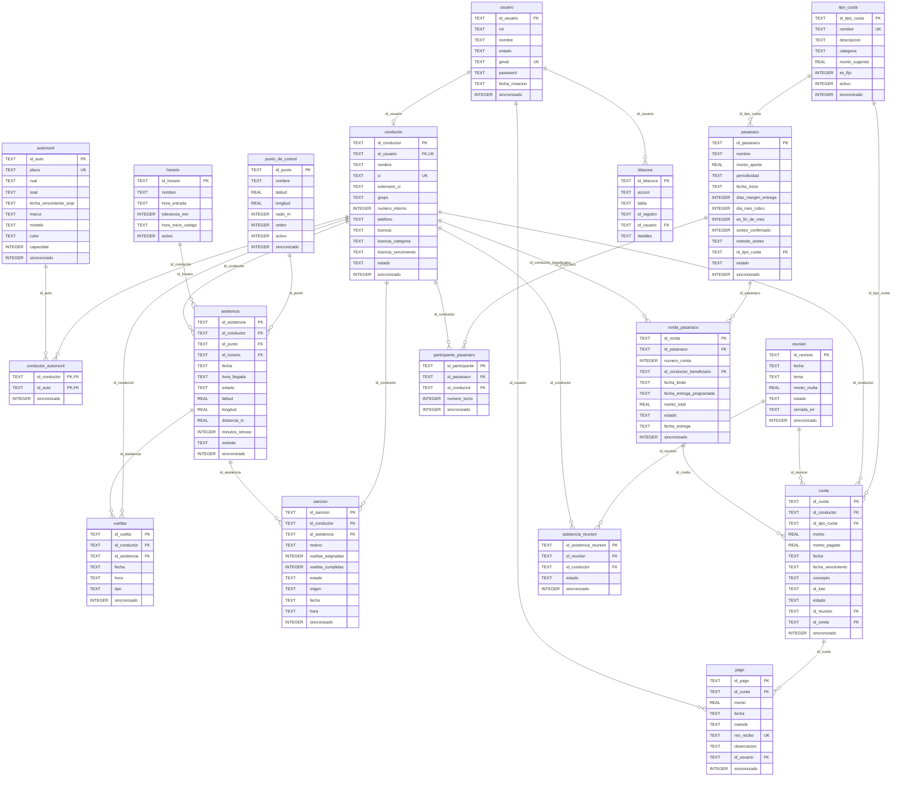

# 🗄️ Base de Datos Oficial Actualizada — Grupo Continental Trufi 101–127

> **Proyecto de Grado:** Aplicación Móvil para el Control de Asistencia y el Cumplimiento de las Sanciones  
> **Caso:** Servicio de Transporte del Radio Taxi Continental (Grupos 101 y 127)  
> **Motores:** SQLite Local (offline en dispositivo) + PostgreSQL / Supabase (sincronización en la nube)  
> **Total de Tablas:** **16 tablas operativas del negocio** (+ 3 tablas de soporte/sistema = **19 tablas en total**)

---

## 📊 1. Resumen: ¿Qué tablas tenía tu documento antes y cuáles se añadieron?

En tu documento PDF figuraban inicialmente **10 tablas**. Con todo lo que desarrollamos (Recibos de pago, Reuniones con multas automáticas, Pasanaku con sorteo y rondas, Horarios y Bitácora), la base de datos real en [`database_helper.dart`](file:///d:/PROYECTO_GRADO/continental/lib/services/database_helper.dart) tiene ahora estas tablas:

| N° | Tabla | Estado respecto al PDF | Módulo al que pertenece |
| :-: | :--- | :--- | :--- |
| 1 | **`usuario`** | Ya estaba (actualizada con rol `tesorero`) | Usuarios y Roles (HU01) |
| 2 | **`conductor`** | Ya estaba (actualizada con grupo `101`/`127`, interno, licencia, etc.) | Conductores (HU02) |
| 3 | **`automovil`** | Ya estaba (placa, RUAT, SOAT, marca, modelo, color) | Conductores / Unidades (HU02) |
| 4 | **`conductor_automovil`** | Ya estaba (relación N:M conductor–vehículo) | Conductores / Unidades (HU02) |
| 5 | **`punto_de_control`** | Ya estaba (Parada A Villadela y Parada B Teleférico + radio GPS) | Asistencia y Vueltas GPS (HU03/HU04) |
| 6 | **`asistencia`** | Ya estaba (marcación GPS, coordenadas, distancia, minutos de retraso) | Asistencia GPS (HU03) |
| 7 | **`vueltas`** | Ya estaba (vueltas de castigo/sanción cumplidas por GPS) | Vueltas GPS (HU04) |
| 8 | **`sancion`** | Ya estaba (tardanzas > 08:00 AM, +2 vueltas asignadas y cumplidas) | Sanciones (HU05) |
| 9 | **`tipo_cuota`** | Ya estaba (catálogo: ayuda, canastón, multa, pasanaco) | Control Económico (HU06) |
| 10 | **`cuota`** | Ya estaba (actualizada con `monto_pagado`, `id_reunion`, `id_ronda`) | Control Económico (HU06) |
| 11 | **`pago`** | **➕ NUEVA** (registra cada cobro parcial o total con `nro_recibo` y método Efectivo/QR) | Control Económico (HU06) |
| 12 | **`reunion`** | **➕ NUEVA** (asambleas del sindicato con fecha, tema y monto de multa por inasistencia) | Reuniones y Multas (HU06) |
| 13 | **`asistencia_reunion`** | **➕ NUEVA** (lista de asistencia de cada conductor por reunión: `presente` / `falta`) | Reuniones y Multas (HU06) |
| 14 | **`pasanaco`** | **➕ NUEVA** (juego de Pasanaku: aporte, frecuencia semanal/mensual, sorteo y +1 día de entrega) | Pasanaku (HU06) |
| 15 | **`participante_pasanaco`** | **➕ NUEVA** (conductores que participan en el Pasanaku y su `numero_turno` sorteado) | Pasanaku (HU06) |
| 16 | **`ronda_pasanaco`** | **➕ NUEVA** (rondas generadas por turno con beneficiario, fecha de cobro y fecha de recojo) | Pasanaku (HU06) |
| 17 | **`horario`** | **➕ NUEVA (Soporte)** (horario oficial 07:30–08:00 AM e inicio de castigo 21:00) | Configuración / Asistencia |
| 18 | **`bitacora`** | **➕ NUEVA (Soporte)** (auditoría de acciones registradas en el sistema) | Seguridad / Auditoría |
| 19 | **`configuracion`** | **➕ NUEVA (Soporte)** (parámetros generales de geocerca y castigo) | Configuración |

---

## 🗺️ 2. Diagrama Entidad–Relación Completo (Mermaid)



---

## 📋 3. Diccionario de Datos de las Nuevas Tablas (Listo para pegar en tu Word)

Si deseas agregar las tablas nuevas a la **Tabla 8 (pág. 47)** y **Tabla 27 (pág. 66–72)** de tu documento, aquí tienes la descripción exacta:

| Tabla | Campo | Tipo | Clave | Descripción |
| :--- | :--- | :--- | :---: | :--- |
| **pago** | `id_pago` | TEXT | PK | Identificador único del pago/recibo (UUID) |
| | `id_cuota` | TEXT | FK | Cuota que se está pagando |
| | `id_usuario` | TEXT | FK | Usuario (Secretario de Hacienda) que cobró |
| | `monto` | REAL | | Monto abonado en bolivianos |
| | `fecha` | TEXT | | Fecha del cobro |
| | `metodo` | TEXT | | Método de pago (`efectivo` o `qr`) |
| | `nro_recibo` | TEXT | Único | Número correlativo de recibo (`REC-2026-...`) |
| **reunion** | `id_reunion` | TEXT | PK | Identificador de la asamblea o reunión (UUID) |
| | `fecha` | TEXT | | Fecha de la reunión |
| | `tema` | TEXT | | Tema o motivo de la asamblea |
| | `monto_multa` | REAL | | Multa automática por inasistencia (ej. Bs 50) |
| | `estado` | TEXT | | `pendiente` o `cerrada` |
| **asistencia_reunion** | `id_asistencia_reunion` | TEXT | PK | Identificador del control en reunión (UUID) |
| | `id_reunion` | TEXT | FK | Reunión controlada |
| | `id_conductor` | TEXT | FK | Conductor evaluado |
| | `estado` | TEXT | | `presente`, `falta` o `permiso` |
| **pasanaco** | `id_pasanaco` | TEXT | PK | Identificador del ciclo de Pasanaku (UUID) |
| | `nombre` | TEXT | | Nombre del Pasanaku |
| | `monto_aporte` | REAL | | Aporte por participante en cada ronda |
| | `periodicidad` | TEXT | | `semanal` o `mensual` |
| | `fecha_inicio` | TEXT | | Fecha del primer cobro |
| | `dias_margen_entrega` | INTEGER | | Días tras el cobro para entregar el pozo (+1 día) |
| | `sorteo_confirmado` | INTEGER | | `1` si el sorteo ya fue cerrado y activó rondas |
| | `metodo_sorteo` | TEXT | | `ruleta`, `fichas`, `random` o `manual` |
| | `estado` | TEXT | | `activo` o `finalizado` |
| **participante_pasanaco** | `id_participante` | TEXT | PK | Identificador del participante (UUID) |
| | `id_pasanaco` | TEXT | FK | Pasanaku en el que participa |
| | `id_conductor` | TEXT | FK | Conductor participante |
| | `numero_turno` | INTEGER | | Número de turno sorteado (`1..N`) |
| **ronda_pasanaco** | `id_ronda` | TEXT | PK | Identificador de la ronda (UUID) |
| | `id_pasanaco` | TEXT | FK | Pasanaku al que pertenece la ronda |
| | `numero_ronda` | INTEGER | | Número de ronda (`1..N`) |
| | `id_conductor_beneficiario` | TEXT | FK | Conductor ganador que recibe el pozo en ese turno |
| | `fecha_limite` | TEXT | | Fecha de cobro de los aportes de la ronda |
| | `fecha_entrega_programada` | TEXT | | Fecha programada de entrega del pozo (+1 día) |
| | `monto_total` | REAL | | Pozo total a entregar en la ronda |
| | `estado` | TEXT | | `pendiente` o `entregada` |

---

## 🎨 4. Prompts para que una IA genere la Imagen del Diagrama Entidad-Relación

### Opción A — Prompt para IA generadora de imágenes (ChatGPT / DALL·E / Ideogram / Gemini Imagen)
> Crea una imagen técnica y limpia de un **Diagrama Entidad-Relación (DER / Modelo Relacional de Base de Datos)** con estilo académico profesional (tipo Enterprise Architect o MySQL Workbench), sobre **fondo blanco puro**, alta resolución, texto nítido en español y líneas ortogonales con notación pata de gallo (Crow's Foot) de cardinalidad (1 a N), para un proyecto de grado titulado "Control de Asistencia, Sanciones y Cuotas – Grupo Continental Trufi 101-127".
>
> Organiza las tablas en cajas rectangulares con encabezado azul/verde institucional (`#02634C`) y bordes finos, divididas en 4 bloques bien ordenados sin cruzar líneas:
> 1. **Bloque Personal y Flota (arriba izquierda):**
>    - `usuario` (`id_usuario PK`, `rol`, `nombre`, `gmail`, `password`, `estado`)
>    - `conductor` (`id_conductor PK`, `id_usuario FK`, `nombre`, `ci`, `grupo`, `numero_interno`, `licencia`, `soat`, `estado`)
>    - `automovil` (`id_auto PK`, `placa`, `ruat`, `soat`, `marca`, `modelo`)
>    - `conductor_automovil` (`id_conductor PK,FK`, `id_auto PK,FK`)
> 2. **Bloque Control Operativo GPS y Sanciones (abajo izquierda):**
>    - `punto_de_control` (`id_punto PK`, `nombre`, `latitud`, `longitud`, `radio_m`)
>    - `horario` (`id_horario PK`, `hora_entrada`, `tolerancia_min`, `hora_inicio_castigo`)
>    - `asistencia` (`id_asistencia PK`, `id_conductor FK`, `id_punto FK`, `id_horario FK`, `fecha`, `hora_llegada`, `minutos_retraso`, `estado`)
>    - `sancion` (`id_sancion PK`, `id_conductor FK`, `id_asistencia FK`, `motivo`, `vueltas_asignadas`, `vueltas_cumplidas`, `estado`)
>    - `vueltas` (`id_vuelta PK`, `id_conductor FK`, `id_asistencia FK`, `fecha`, `hora`, `tipo`)
> 3. **Bloque Control Económico y Reuniones (arriba derecha):**
>    - `tipo_cuota` (`id_tipo_cuota PK`, `nombre`, `categoria`, `monto_sugerido`, `es_fijo`)
>    - `cuota` (`id_cuota PK`, `id_conductor FK`, `id_tipo_cuota FK`, `id_reunion FK`, `id_ronda FK`, `monto`, `monto_pagado`, `fecha_vencimiento`, `estado`)
>    - `pago` (`id_pago PK`, `id_cuota FK`, `id_usuario FK`, `monto`, `metodo`, `nro_recibo`, `fecha`)
>    - `reunion` (`id_reunion PK`, `fecha`, `tema`, `monto_multa`, `estado`)
>    - `asistencia_reunion` (`id_asistencia_reunion PK`, `id_reunion FK`, `id_conductor FK`, `estado`)
> 4. **Bloque Pasanaku (abajo derecha):**
>    - `pasanaco` (`id_pasanaco PK`, `id_tipo_cuota FK`, `nombre`, `monto_aporte`, `periodicidad`, `fecha_inicio`, `dias_margen_entrega`, `sorteo_confirmado`, `estado`)
>    - `participante_pasanaco` (`id_participante PK`, `id_pasanaco FK`, `id_conductor FK`, `numero_turno`)
>    - `ronda_pasanaco` (`id_ronda PK`, `id_pasanaco FK`, `id_conductor_beneficiario FK`, `numero_ronda`, `fecha_limite`, `fecha_entrega_programada`, `monto_total`, `estado`)
>
> Conecta claramente con líneas de clave foránea: `usuario` 1:1 `conductor`; `conductor` 1:N `asistencia`, `vueltas`, `sancion`, `cuota`, `asistencia_reunion`, `participante_pasanaco`, `ronda_pasanaco`; `asistencia` 1:N `sancion` y `vueltas`; `cuota` 1:N `pago`; `pasanaco` 1:N `participante_pasanaco` y `ronda_pasanaco`. Estilo vectorial limpio, listo para imprimir en documento académico Word/PDF.

### Opción B — Código directo para `dbdiagram.io` (Genera el diagrama exacto sin errores de ortografía en 5 segundos)
Si entras a **https://dbdiagram.io/d** y pegas este bloque, te dibuja el diagrama perfecto y puedes exportarlo en **PNG o PDF de alta calidad**:

```dbml
Table usuario {
  id_usuario text [pk]
  rol text
  nombre text
  gmail text [unique]
  password text
  estado text
  sincronizado integer
}

Table conductor {
  id_conductor text [pk]
  id_usuario text [ref: - usuario.id_usuario]
  nombre text
  ci text [unique]
  grupo text
  numero_interno integer
  licencia text
  licencia_vencimiento text
  estado text
  sincronizado integer
}

Table automovil {
  id_auto text [pk]
  placa text [unique]
  ruat text
  soat text
  fecha_vencimiento_soat text
  marca text
  modelo text
  sincronizado integer
}

Table conductor_automovil {
  id_conductor text [pk, ref: > conductor.id_conductor]
  id_auto text [pk, ref: > automovil.id_auto]
  sincronizado integer
}

Table punto_de_control {
  id_punto text [pk]
  nombre text
  latitud real
  longitud real
  radio_m integer
  activo integer
}

Table horario {
  id_horario text [pk]
  nombre text
  hora_entrada text
  tolerancia_min integer
  hora_inicio_castigo text
}

Table asistencia {
  id_asistencia text [pk]
  id_conductor text [ref: > conductor.id_conductor]
  id_punto text [ref: > punto_de_control.id_punto]
  id_horario text [ref: > horario.id_horario]
  fecha text
  hora_llegada text
  estado text
  latitud real
  longitud real
  minutos_retraso integer
  sincronizado integer
}

Table sancion {
  id_sancion text [pk]
  id_conductor text [ref: > conductor.id_conductor]
  id_asistencia text [ref: > asistencia.id_asistencia]
  motivo text
  vueltas_asignadas integer
  vueltas_cumplidas integer
  estado text
  fecha text
  hora text
  sincronizado integer
}

Table vueltas {
  id_vuelta text [pk]
  id_conductor text [ref: > conductor.id_conductor]
  id_asistencia text [ref: > asistencia.id_asistencia]
  fecha text
  hora text
  tipo text
  sincronizado integer
}

Table tipo_cuota {
  id_tipo_cuota text [pk]
  nombre text [unique]
  categoria text
  monto_sugerido real
  es_fijo integer
  activo integer
}

Table cuota {
  id_cuota text [pk]
  id_conductor text [ref: > conductor.id_conductor]
  id_tipo_cuota text [ref: > tipo_cuota.id_tipo_cuota]
  id_reunion text [ref: > reunion.id_reunion]
  id_ronda text [ref: > ronda_pasanaco.id_ronda]
  monto real
  monto_pagado real
  fecha text
  fecha_vencimiento text
  concepto text
  estado text
  sincronizado integer
}

Table pago {
  id_pago text [pk]
  id_cuota text [ref: > cuota.id_cuota]
  id_usuario text [ref: > usuario.id_usuario]
  monto real
  fecha text
  metodo text
  nro_recibo text [unique]
  sincronizado integer
}

Table reunion {
  id_reunion text [pk]
  fecha text
  tema text
  monto_multa real
  estado text
  sincronizado integer
}

Table asistencia_reunion {
  id_asistencia_reunion text [pk]
  id_reunion text [ref: > reunion.id_reunion]
  id_conductor text [ref: > conductor.id_conductor]
  estado text
  sincronizado integer
}

Table pasanaco {
  id_pasanaco text [pk]
  id_tipo_cuota text [ref: > tipo_cuota.id_tipo_cuota]
  nombre text
  monto_aporte real
  periodicidad text
  fecha_inicio text
  dias_margen_entrega integer
  dia_mes_cobro integer
  es_fin_de_mes integer
  sorteo_confirmado integer
  metodo_sorteo text
  estado text
  sincronizado integer
}

Table participante_pasanaco {
  id_participante text [pk]
  id_pasanaco text [ref: > pasanaco.id_pasanaco]
  id_conductor text [ref: > conductor.id_conductor]
  numero_turno integer
  sincronizado integer
}

Table ronda_pasanaco {
  id_ronda text [pk]
  id_pasanaco text [ref: > pasanaco.id_pasanaco]
  id_conductor_beneficiario text [ref: > conductor.id_conductor]
  numero_ronda integer
  fecha_limite text
  fecha_entrega_programada text
  monto_total real
  estado text
  fecha_entrega text
  sincronizado integer
}
```
