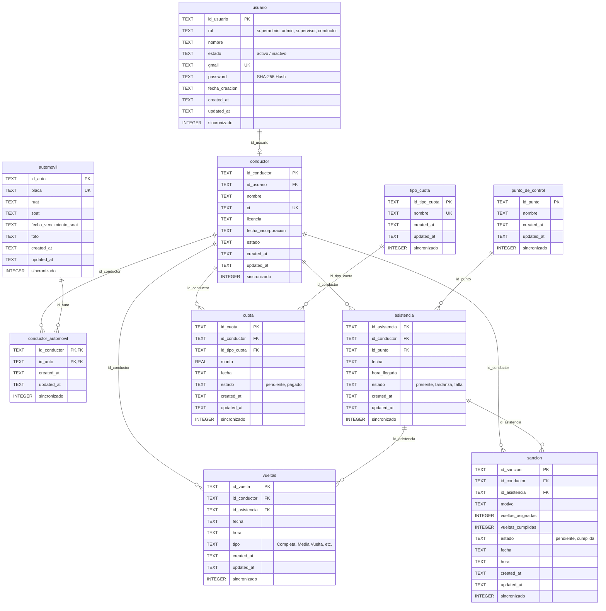

# 🗄️ Documentación de Base de Datos y Migración SQLite

> **Proyecto de Grado:** Continental Trufi  
> **Sistema:** Control, Gestión y Monitoreo de Transporte Público  
> **Motor de Persistencia:** SQLite Local (mediante `sqflite`, `crypto`, `uuid`, `path`)  
> **Fecha de Implementación:** Octubre 2026  

---

## 📋 Resumen de la Intervención

Se realizó una **depuración integral del proyecto**, eliminando el 100% de los datos quemados (*mock data* / listas estáticas en memoria) que simulaban el funcionamiento del sistema.

Se implementó una arquitectura relacional robusta en **SQLite** mediante la clase centralizada [`DatabaseHelper`](file:///d:/PROYECTO_GRADO/continental/lib/services/database_helper.dart), conectando todas las pantallas de la aplicación a consultas SQL dinámicas en tiempo real con transacciones atómicas y seguridad mediante cifrado de contraseñas.

---

## 🗂️ Modelo Entidad - Relación (Diagrama de Tablas)



---

## 🏛️ Descripción Detallada de las Tablas (SQLite)

Todas las tablas cuentan con llaves primarias universales (`UUID v4`) y columnas estándar preparadas para sincronización bidireccional con una futura nube:
* `created_at` (TEXT en formato ISO 8601).
* `updated_at` (TEXT en formato ISO 8601).
* `sincronizado` (INTEGER: `0` = pendiente de subir, `1` = sincronizado con el servidor).

### 1. `usuario`
Almacena las credenciales principales del sistema.
* **Roles soportados:** `superadmin`, `admin`, `supervisor`, `conductor` (validado mediante `CHECK`).
* **Regla de negocio:** El personal administrativo debe registrar obligatoriamente correo electrónico (`gmail IS NOT NULL`), mientras que el conductor puede ingresar únicamente con su Cédula de Identidad (**CI**).

### 2. `conductor`
Ficha técnica del afiliado / chofer. Vinculado a `usuario` mediante `id_usuario` (`FOREIGN KEY ... ON DELETE CASCADE`).
* Registra nombre, CI único, licencia de conducir, fecha de incorporación y estado operativo.

### 3. `automovil`
Vehículos pertenecientes a la línea/sindicato Continental.
* Contiene placa única, RUAT, SOAT, fecha de vencimiento y registro fotográfico.

### 4. `conductor_automovil`
Tabla de asociación de muchos a muchos (N:M) con llave primaria compuesta `(id_conductor, id_auto)` para gestionar qué conductor maneja qué unidad o cambio de turnos de vehículos.

### 5. `punto_de_control`
Puntos geográficos o paradas estratégicas de control (ej. Cruce Villadela, Parada Central, Teleférico, etc.).

### 6. `asistencia`
Control de registro diario de llegada a puntos de control.
* Estados: `presente`, `tardanza`, `falta`.

### 7. `vueltas`
Cronometraje y conteo de recorridos o turnos realizados por cada unidad en el día.

### 8. `tipo_cuota`
Catálogo de conceptos de pago (ej. *Cuota Mensual*, *Extraordinaria*, *Multa*).

### 9. `cuota`
Registro contable de aportes económicos y deudas.
* Vinculada a conductor y tipo de cuota, registrando el monto y estado (`pendiente` o `pagado`).

### 10. `sancion`
Infracciones registradas a conductores (retrasos, faltas a asambleas, desvíos).
* Gestiona vueltas de castigo asignadas y cumplidas.

---

## 🔑 Cuentas Semilla Iniciales (*Seed Data*)

Al iniciarse la aplicación por primera vez, SQLite autoejecuta el método `_seed(...)` insertando automáticamente las cuentas base del personal administrativo y los tipos de cuotas con contraseñas hasheadas en SHA-256:

| Rol | Nombre | Identificador / Correo | Contraseña Plana |
| :--- | :--- | :--- | :--- |
| **Superadmin** | Super Administrador | `superadmin@continental.com` | `super123` |
| **Admin** | Administrador | `admin@continental.com` | `admin123` |
| **Supervisor** | Supervisor | `supervisor@continental.com` | `supervisor123` |

> 💡 **Nota:** Los conductores pueden registrarse desde la pantalla de Registro o mediante el botón "Agregar Conductor" e ingresarán con su **CI** y su contraseña personal.

---

## 🔄 Detalle de Archivos Modificados y Datos Borrados

A continuación se detalla todo el trabajo realizado archivo por archivo:

### 1. `continental/pubspec.yaml`
* **Agregado:** Paquetes `uuid: ^4.4.0` (generación de llaves primarias únicas) y `crypto: ^3.0.3` (algoritmo SHA-256 para contraseñas).
* Se ejecutó `flutter pub get` con resolución exitosa de dependencias.

### 2. `lib/services/database_helper.dart`
* **Antes:** Contenía una lista simulada en memoria `_webDb` y una tabla básica `users` sin relaciones.
* **Ahora:** Clase `DatabaseHelper` completa con:
  * Creación e indexación de las 9 tablas (`PRAGMA foreign_keys = ON`).
  * Índices rápidos para asistencias, vueltas, cuotas y sanciones.
  * CRUD Genérico (`insertar`, `listar`, `obtener`, `actualizar`, `eliminar`).
  * Autenticación dual inteligente (`login(identificador, password)`). Si contiene `@` busca por correo; si no, busca por CI del conductor.
  * Transacciones ACID (`registrarConductor`) que crean el usuario y la ficha del conductor de forma indivisible.
  * Métodos especializados con `JOIN` para pantallas (`conductoresConAuto`, `asistenciasDetalle`, `vueltasDetalle`, `sancionesDetalle`, `cuotasDetalle`).
  * Cálculo estadístico dinámico (`resumenHome`).

### 3. `lib/models/usuario_model.dart`
* **Datos quemados eliminados:** Se borró por completo el bloque estático `currentUser => Usuario(id: 'U001', nombre: 'Michael Crispin Mamani', rol: 'Encargado', ci: '12345678', numeroTrufi: '115', estado: 'Activo')`.
* **Nueva implementación:** Se agregó `static Usuario? currentUser;` (dinámico en sesión), constructor `Usuario.fromMap(...)` y método `toMap()`.

### 4. `lib/models/ruta_model.dart`
* **Datos quemados eliminados:** Se borró el getter estático `currentRuta` con nombres de conductor ficticios y paradas duras en el código.
* **Nueva implementación:** Modelos `Ruta` y `Parada` preparados para recibir registros de puntos desde SQLite.

### 5. `lib/screens/login_screen.dart`
* **Antes:** Verificaba contra un método dummy y navegaba directamente sin guardar sesión.
* **Ahora:** Consume `DatabaseHelper.instance.login(user, pass)`. Al autenticar, mapea el registro a `Usuario.currentUser` y navega al Dashboard con el perfil autenticado.

### 6. `lib/screens/register_screen.dart`
* **Antes:** Solo tenía un botón que abría `HomeScreen` sin guardar nada.
* **Ahora:** Conectado con controladores a `DatabaseHelper.instance.registrarConductor(...)`. Valida campos, confirma contraseñas, encripta y guarda el conductor en SQLite.

### 7. `lib/screens/home_screen.dart`
* **Datos quemados eliminados:**
  * Tarjetas con números inventados: *"38 / 40 conductores"*, *"76 vueltas"*, *"2 sanciones"*, *"Bs. 1.250 en cuotas"*.
  * Saludo estático *"Hola, Encargado"* y fecha estática *"17 de septiembre de 2026"*.
* **Ahora:**
  * Saludo personalizado con `Usuario.currentUser?.nombre`.
  * Fecha actual dinámica calculada con `DateTime.now()`.
  * Estadísticas en tiempo real obtenidas de `DatabaseHelper.instance.resumenHome()` y conteo de vueltas de hoy.

### 8. `lib/screens/conductores_screen.dart`
* **Datos quemados eliminados:** La lista dura en memoria:
  ```dart
  final List<Map<String, dynamic>> _conductores = const [
    {'name': 'Juan Pérez', 'ci': '12345678', 'unit': '115'},
    {'name': 'Pedro Quispe', ...}, ...
  ];
  ```
* **Ahora:** Consulta en vivo `DatabaseHelper.instance.conductoresConAuto()`, buscador en tiempo real por nombre/CI/placa, mensaje de lista vacía cuando no hay registros y diálogo modal "Agregar Conductor" con guardado directo en SQLite.

### 9. `lib/screens/asistencia_screen.dart`
* **Datos quemados eliminados:** Lista estática de choferes con estados inventados y fecha fija.
* **Ahora:** Selector interactivo de fecha con `showDatePicker`, consulta en tiempo real mediante `asistenciasDetalle(fecha)`, listado de puntos de control de SQLite y botón "Registrar Asistencia" con selección de chofer y punto de control.

### 10. `lib/screens/sanciones_screen.dart`
* **Datos quemados eliminados:** Lista estática de sanciones pendientes y en proceso.
* **Ahora:** Consulta `sancionesDetalle(estado)` filtrando por pestañas (*Todas / Pendientes / Cumplidas*), buscador y diálogo para registrar sanciones en la base de datos.

### 11. `lib/screens/control_economico_screen.dart`
* **Datos quemados eliminados:** Los valores fijos *"Bs. 2.450"* (Recaudación) y *"Bs. 350"* (Pagos pendientes).
* **Ahora:** Suma aritmética en vivo de las cuotas con estado `pagado` y `pendiente`, muestra los tipos de cuota registrados en la base de datos y permite registrar nuevas cuotas/aportes.

### 12. `lib/screens/vueltas_screen.dart`
* **Antes:** Pantalla con texto de marcador de posición *"Vista de Vueltas"*.
* **Ahora:** Pantalla funcional conectada a `vueltasDetalle(fecha)`, con selector de fecha, lista de vueltas completadas y modal para despachar turnos a conductores.

### 13. `lib/screens/informes_screen.dart`
* **Datos quemados eliminados:** Resumen con datos fijos ("38 presentes", "76 completadas", etc.).
* **Ahora:** Genera informes diarios automáticos sumando asistencias, vueltas, sanciones y montos recaudados de la base de datos para cualquier fecha elegida.

### 14. `lib/screens/gps_screen.dart`
* **Datos quemados eliminados:** Texto fijo *"Trufi 115 • Juan Pérez"*.
* **Ahora:** Carga unidades reales de SQLite y puntos de control, permitiendo alternar entre conductores registrados.

### 15. `lib/screens/perfil_screen.dart`
* **Antes:** Invocaba el mock hardcodeado.
* **Ahora:** Lee los datos de `Usuario.currentUser`, muestra el rol y datos reales, y al presionar "Cerrar sesión" limpia la sesión y redirige a `LoginScreen`.

---

## 🎯 Verificación y Calidad de Código
Se ejecutó la herramienta de análisis estático del SDK de Flutter:
```bash
flutter analyze
```
* **Errores:** 0
* **Advertencias:** 0
* **Compilación:** Limpia y lista para ejecución en dispositivos o emuladores Android/iOS/Desktop.
