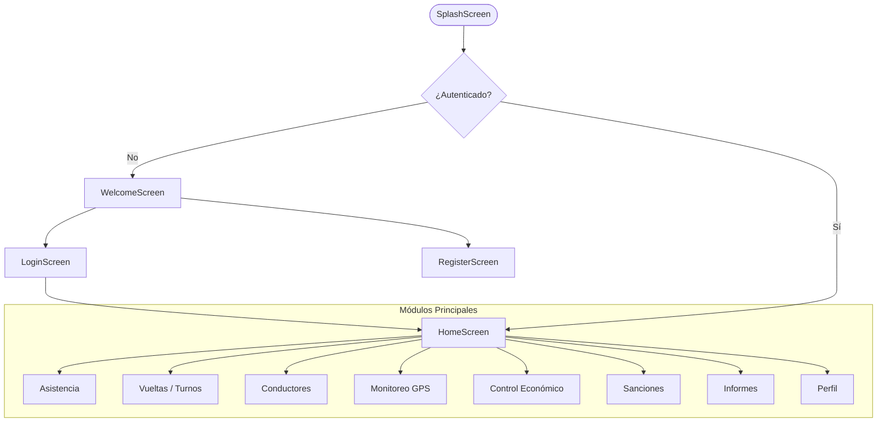

# 📁 Estructura del Proyecto: Continental Trufi

> **Proyecto de Grado**  
> Sistema de Gestión y Monitoreo para el Sindicato / Línea de Transporte "Continental Trufi".  
> Desarrollado con **Flutter** y **Dart**.

---

## 🌳 Árbol General del Directorio

```text
PROYECTO_GRADO/
│
├── .vscode/                               # Configuraciones del editor Visual Studio Code
│   ├── launch.json                        # Perfiles de depuración y ejecución
│   └── settings.json                      # Preferencias del espacio de trabajo
│
├── continental/                           # Directorio principal de la aplicación Flutter
│   ├── android/                           # Código nativo y configuración para Android
│   ├── assets/                            # Recursos estáticos (imágenes, logos, iconos)
│   │   └── images/
│   │       ├── icono_auto_al_frente.png   # Icono representativo de vehículo / trufi
│   │       └── logo.png                   # Logotipo oficial del sistema
│   │
│   ├── ios/                               # Código nativo y configuración para iOS (Apple)
│   ├── lib/                               # Código fuente principal en Dart
│   │   ├── core/                          # Constantes globales, colores y temas
│   │   │   ├── app_colors.dart            # Paleta de colores institucional
│   │   │   └── app_theme.dart             # Definición del ThemeData (estilos globales)
│   │   │
│   │   ├── models/                        # Modelos de datos (entidades del negocio)
│   │   │   ├── ruta_model.dart            # Modelo para rutas, paradas y recorridos
│   │   │   └── usuario_model.dart         # Modelo para usuarios, roles y credenciales
│   │   │
│   │   ├── screens/                       # Vistas / Pantallas de la aplicación
│   │   │   ├── asistencia_screen.dart     # Registro y control de asistencia de afiliados
│   │   │   ├── conductores_screen.dart    # Directorio y gestión de conductores/choferes
│   │   │   ├── control_economico_screen.dart # Gestión de aportes, caja y cuotas
│   │   │   ├── gps_screen.dart            # Mapa interactivo y rastreo GPS en tiempo real
│   │   │   ├── home_screen.dart           # Tablero principal (Dashboard) con accesos rápidos
│   │   │   ├── informes_screen.dart       # Generación y visualización de reportes
│   │   │   ├── login_screen.dart          # Pantalla de inicio de sesión
│   │   │   ├── perfil_screen.dart         # Información de la cuenta del usuario actual
│   │   │   ├── register_screen.dart       # Registro de nuevos usuarios / conductores
│   │   │   ├── sanciones_screen.dart      # Registro de infracciones, multas y sanciones
│   │   │   ├── splash_screen.dart         # Pantalla de bienvenida / carga inicial
│   │   │   ├── vueltas_screen.dart        # Control de turnos, vueltas y tiempos
│   │   │   └── welcome_screen.dart        # Pantalla introductoria de bienvenida
│   │   │
│   │   ├── services/                      # Servicios y lógica de persistencia de datos
│   │   │   └── database_helper.dart       # Gestor de base de datos SQLite (soporte móvil y web)
│   │   │
│   │   ├── widgets/                       # Componentes visuales reutilizables
│   │   │   ├── app_background.dart        # Fondo decorativo unificado para pantallas
│   │   │   ├── custom_app_bar.dart        # Barra superior personalizada
│   │   │   ├── custom_list_tile.dart      # Elemento de lista estilizado
│   │   │   ├── glass_card.dart            # Tarjeta con efecto Glassmorphism (vidrio esmerilado)
│   │   │   ├── info_row.dart              # Fila de detalle para datos clave-valor
│   │   │   └── wave_header.dart           # Cabecera ondulada decorativa moderna
│   │   │
│   │   └── main.dart                      # Punto de entrada de la aplicación Flutter
│   │
│   ├── linux/                             # Soporte y configuración para Linux Desktop
│   ├── macos/                             # Soporte y configuración para macOS Desktop
│   ├── test/                              # Pruebas unitarias y de widgets
│   │   └── widget_test.dart               # Pruebas automatizadas de interfaz
│   │
│   ├── web/                               # Soporte y archivos base para navegadores Web
│   ├── windows/                           # Soporte y configuración para Windows Desktop
│   │
│   ├── analysis_options.yaml              # Reglas de análisis de código y linter de Dart
│   ├── pubspec.yaml                       # Manifiesto de dependencias, fuentes y assets
│   ├── pubspec.lock                       # Registro de versiones exactas de paquetes
│   └── README.md                          # Documentación básica de Flutter
│
└── ESTRUCTURA_PROYECTO.md                 # Este documento de arquitectura
```

---

## 📦 Detalle de los Módulos de `lib/`

### 1. `lib/core/` (Estilo y Configuración Base)
Contiene las bases estéticas y parámetros compartidos de la interfaz:
* **`app_colors.dart`**: Define los colores corporativos y auxiliares (primario, secundario, fondos, acentos, etc.).
* **`app_theme.dart`**: Centraliza la configuración de `ThemeData`, tipografías con Google Fonts y estilos de botones y campos de texto.

### 2. `lib/models/` (Modelos de Datos)
Representan las entidades de información que maneja el negocio:
* **`usuario_model.dart`**: Maneja información del usuario (id, nombre, CI, número de trufi, rol de Encargado/Conductor/Admin, estado).
* **`ruta_model.dart`**: Modela los puntos geográficos, coordenadas, nombres de parada y trayectos de las líneas de trufis.

### 3. `lib/screens/` (Vistas y Flujos de Usuario)
Agrupa todas las interfaces que el usuario final interactúa:
* **Flujo de Acceso:**
  * `splash_screen.dart`: Carga inicial con logo y redirección automática.
  * `welcome_screen.dart`: Presentación inicial del sistema.
  * `login_screen.dart`: Validación de credenciales.
  * `register_screen.dart`: Alta de nuevas cuentas.
* **Flujo Operativo (Gestión del Transporte):**
  * `home_screen.dart`: Menú central con accesos directos por módulos.
  * `asistencia_screen.dart`: Marcado de asistencia diaria por unidad y conductor.
  * `vueltas_screen.dart`: Registro de salidas, llegadas y cronometraje de vueltas.
  * `conductores_screen.dart`: Lista, filtrado y ficha de conductores registrados.
  * `gps_screen.dart`: Visualización cartográfica interactiva mediante `flutter_map` y `latlong2`.
* **Flujo Administrativo y Financiero:**
  * `control_economico_screen.dart`: Ingresos, egresos, caja chica y recaudación por vehículo.
  * `sanciones_screen.dart`: Registro de faltas (retrasos, desvíos de ruta, infracciones internas).
  * `informes_screen.dart`: Resúmenes y reportes ejecutivos para la directiva.
  * `perfil_screen.dart`: Visualización y configuración del perfil personal.

### 4. `lib/services/` (Servicios y Datos)
* **`database_helper.dart`**: Capa de persistencia local mediante SQLite (`sqflite`), con soporte condicional simulado en memoria cuando se ejecuta en entorno Web (`kIsWeb`).

### 5. `lib/widgets/` (Componentes UI Reutilizables)
Facilitan una experiencia visual consistente con estética moderna:
* **`app_background.dart`**: Gradiente y textura de fondo unificada.
* **`glass_card.dart`**: Contenedor con efecto de desenfoque de cristal (glassmorphism).
* **`wave_header.dart`**: Cabecera decorativa con curvas fluidas.
* **`custom_app_bar.dart`**: Barra de navegación superior estandarizada.
* **`custom_list_tile.dart`**: Fila interactiva para listas estilizadas.
* **`info_row.dart`**: Componente rápido para pares clave-valor (ej. "N° Trufi: 115").

---

## 🛠️ Tecnologías y Librerías Principales

| Paquete / Tecnología | Versión | Propósito |
| :--- | :--- | :--- |
| **Flutter SDK** | `^3.12.2` | Framework base para desarrollo multiplataforma |
| **sqflite** | `^2.4.4` | Base de datos relacional local (SQLite) |
| **path** | `^1.9.1` | Manejo seguro de rutas de archivos y bases de datos |
| **flutter_map** | `^8.3.2` | Visualización y renderizado de mapas OpenStreetMap |
| **latlong2** | `^0.10.1` | Cálculos geoespaciales y coordenadas geográficas |
| **google_fonts** | `^8.2.1` | Tipografías modernas integradas en la aplicación |
| **cupertino_icons** | `^1.0.8` | Iconografía estilo iOS y Material Icons |

---

## 🗺️ Flujo de Navegación del Sistema


