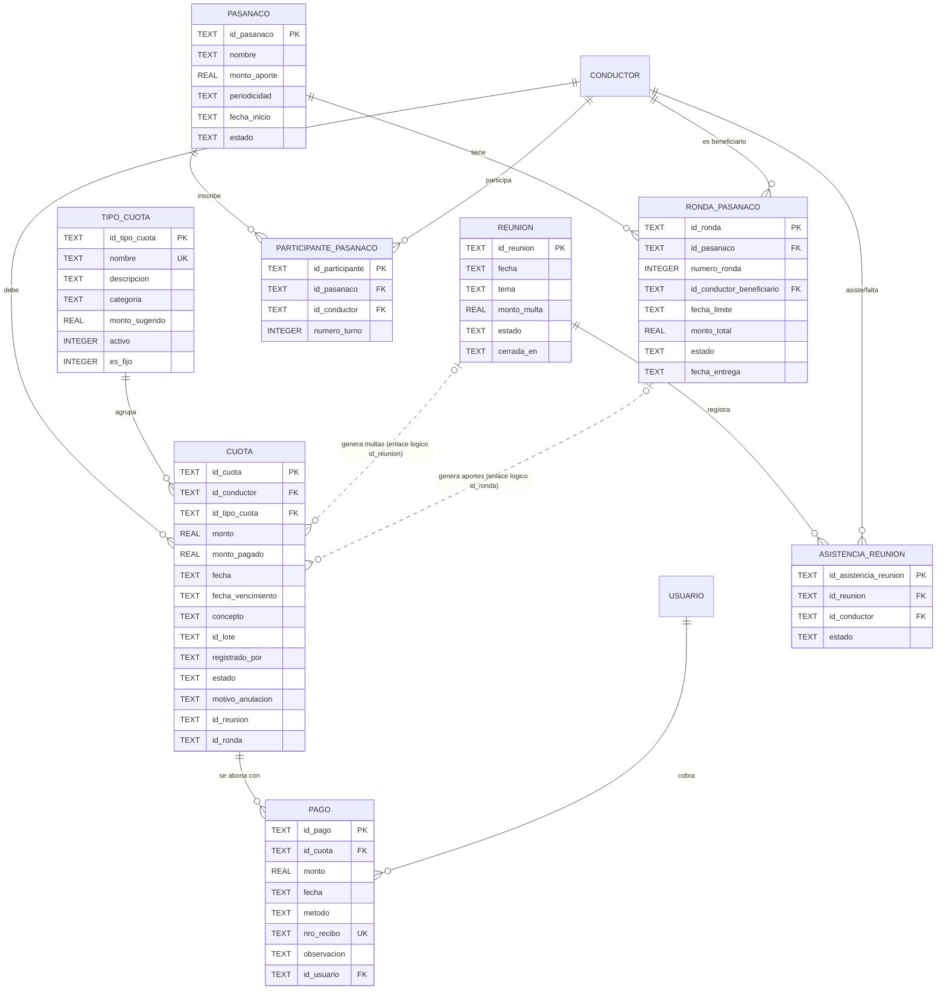
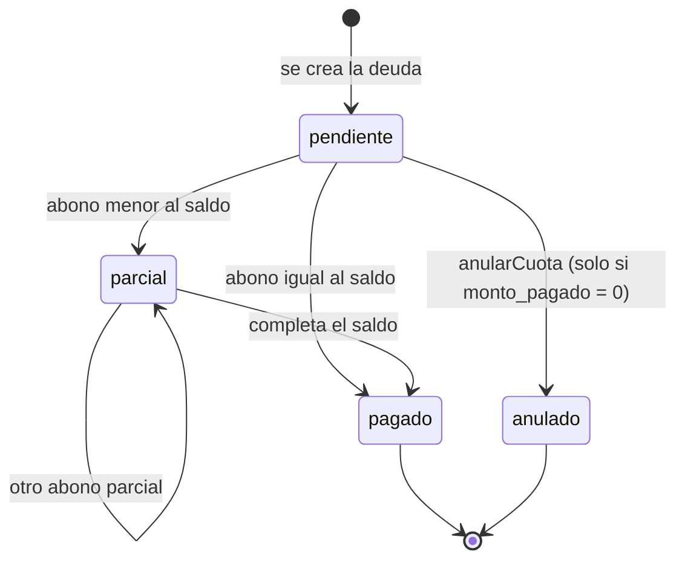
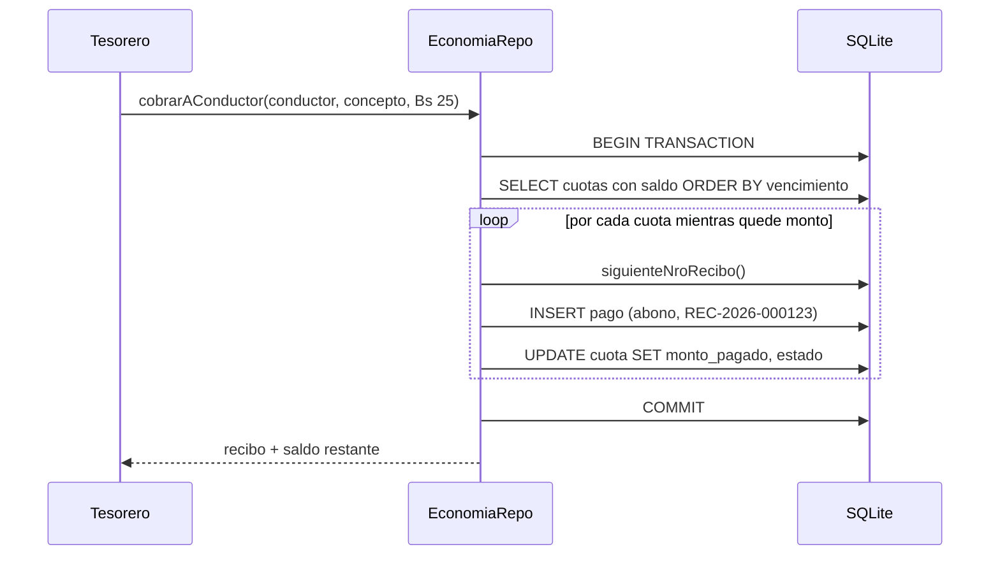

# Análisis de la Base de Datos — Módulo de Cuotas (Control Económico)

**Proyecto:** Continental Trufi · App Flutter + SQLite (`sqflite`)
**Archivo de BD:** `continental.db` · **Versión de esquema:** `10`
**Fuentes analizadas:**
- Esquema: [database_helper.dart](file:///d:/PROYECTO_GRADO/continental/lib/services/database_helper.dart#L807-L938) (`_onCreate`) y migraciones [`_onUpgrade`](file:///d:/PROYECTO_GRADO/continental/lib/services/database_helper.dart#L191-L397)
- Lógica de negocio: [economia_repo.dart](file:///d:/PROYECTO_GRADO/continental/lib/services/economia_repo.dart)
- Semilla: [`_seedCuotasAyudaYReunion`](file:///d:/PROYECTO_GRADO/continental/lib/services/database_helper.dart#L1285-L1652)

> [!NOTE]
> Este documento describe la **estructura** de la base de datos y los datos que crea la **semilla**. Los registros reales del celular (pagos hechos a mano, cuotas creadas desde la app) no se pueden leer desde el código.

---

## Índice
1. [Resumen general](#1-resumen-general)
2. [Diagrama entidad–relación](#2-diagrama-entidadrelación)
3. [Diccionario de datos (tabla por tabla)](#3-diccionario-de-datos)
4. [Valores permitidos (dominios)](#4-valores-permitidos-dominios)
5. [Índices](#5-índices)
6. [Ciclo de vida y flujos de negocio](#6-ciclo-de-vida-y-flujos-de-negocio)
7. [Cálculos y reglas de los dashboards](#7-cálculos-y-reglas-de-los-dashboards)
8. [Historial de migraciones](#8-historial-de-migraciones)
9. [Datos sembrados actualmente](#9-datos-sembrados-actualmente)
10. [Problemas encontrados (bugs y riesgos)](#10-problemas-encontrados)
11. [Recomendaciones y migración propuesta v11](#11-recomendaciones-y-migración-propuesta-v11)
12. [Consultas SQL útiles para auditar](#12-consultas-sql-útiles-para-auditar)

---

## 1. Resumen general

El módulo de Cuotas usa **8 tablas** propias y **2 tablas externas** (`conductor` y `usuario`):

| # | Tabla | Rol | Tipo |
|---|---|---|---|
| 1 | `tipo_cuota` | Catálogo de conceptos (lo que la app muestra como "una cuota": un Apoyo Económico, un Canastón, una Multa) | Maestra |
| 2 | `cuota` | La **deuda individual** de cada conductor dentro de un concepto | Transaccional (central) |
| 3 | `pago` | Cada **abono / cobro** con su recibo correlativo | Transaccional |
| 4 | `reunion` | Asambleas del sindicato | Maestra |
| 5 | `asistencia_reunion` | Asistencia de cada chofer a una reunión | Detalle |
| 6 | `pasanaco` | Fondo rotativo | Maestra |
| 7 | `participante_pasanaco` | Choferes inscritos y su turno | Detalle |
| 8 | `ronda_pasanaco` | Cada ronda: quién recibe el pozo y cuándo | Detalle |

**Idea central del diseño:** todo lo que significa dinero (ayudas, canastón, multas de reunión, aportes de pasanaco) **termina siendo filas en `cuota`**, y todo cobro termina en `pago`. Gracias a eso, los dashboards y el estado de cuenta funcionan igual para cualquier tipo de cuota.

**Convenciones comunes a todas las tablas:**
- PK de tipo `TEXT` con **UUID v4** (sirve para una futura sincronización con la nube, sin choques de IDs).
- Columnas de auditoría y sincronización: `created_at`, `updated_at` (ISO‑8601) y `sincronizado` (`0` = pendiente de subir, `1` = subido).
- Fechas guardadas como `TEXT`: `YYYY-MM-DD` para fechas de negocio y ISO completo para marcas de tiempo.
- `PRAGMA foreign_keys = ON` se activa en `onConfigure`, así que las FK **sí se respetan**.

---

## 2. Diagrama entidad–relación



> [!IMPORTANT]
> Las líneas punteadas (`id_reunion`, `id_ronda`) son **enlaces lógicos sin FOREIGN KEY**: la base de datos no garantiza que el registro apuntado exista (ver problema [P‑04](#p-04-id_reunion-e-id_ronda-sin-foreign-key)).

---

## 3. Diccionario de datos

### 3.1 `tipo_cuota` — Catálogo de conceptos

| Columna | Tipo | Nulo | Default | Restricción | Descripción |
|---|---|---|---|---|---|
| `id_tipo_cuota` | TEXT | No | — | **PK** | UUID |
| `nombre` | TEXT | No | — | **UNIQUE** | Título visible (ej. "Apoyo Económico - Salud Roberto Vargas") |
| `descripcion` | TEXT | Sí | — | | Texto libre. En las ayudas guarda `Beneficiario: X \| Modalidad: Y \| Motivo: Z` |
| `categoria` | TEXT | No | `'ayuda'` | | `ayuda` · `multa` · `canaston` |
| `monto_sugerido` | REAL | Sí | `0` | | Monto por chofer (o por cuota en el Canastón) |
| `activo` | INTEGER | No | `1` | | 1 = visible, 0 = oculto |
| `es_fijo` | INTEGER | No | `0` | | En las ayudas: 1 = obligatoria, 0 = voluntaria. Las multas y el pasanaco se crean con 1 |
| `created_at` / `updated_at` / `sincronizado` | | | | | Auditoría |

**Cardinalidad:** 1 `tipo_cuota` → N `cuota`.
**Protección:** `cuota.id_tipo_cuota` tiene `ON DELETE RESTRICT`, así que no se puede borrar un concepto que tenga deudas, salvo que antes se borren esas deudas (lo hace [`eliminarTipoCuota`](file:///d:/PROYECTO_GRADO/continental/lib/services/economia_repo.dart#L431-L457)).

---

### 3.2 `cuota` — Deuda individual (tabla central)

| Columna | Tipo | Nulo | Default | Restricción | Descripción |
|---|---|---|---|---|---|
| `id_cuota` | TEXT | No | — | **PK** | UUID |
| `id_conductor` | TEXT | No | — | **FK → conductor** `ON DELETE CASCADE` | Quién debe |
| `id_tipo_cuota` | TEXT | No | — | **FK → tipo_cuota** `ON DELETE RESTRICT` | A qué concepto pertenece |
| `monto` | REAL | No | — | | Total que debe pagar |
| `monto_pagado` | REAL | No | `0` | | Acumulado de abonos (**dato derivado**, ver P‑06) |
| `fecha` | TEXT | No | — | | Fecha en que se generó la deuda |
| `fecha_vencimiento` | TEXT | Sí | — | | Fecha límite. En el Canastón, cada cuota del cronograma tiene la suya |
| `concepto` | TEXT | Sí | — | | Texto para el recibo (ej. "Canastón 2026 · Cuota 3 de 10") |
| `id_lote` | TEXT | Sí | — | índice | Agrupa todas las deudas creadas en una misma operación masiva |
| `registrado_por` | TEXT | Sí | — | (sin FK) | `id_usuario` de quien creó la deuda |
| `estado` | TEXT | No | `'pendiente'` | | `pendiente` · `parcial` · `pagado` · `anulado` |
| `motivo_anulacion` | TEXT | Sí | — | | Obligatorio al anular |
| `id_reunion` | TEXT | Sí | — | **sin FK** | Si es una multa por falta a una reunión |
| `id_ronda` | TEXT | Sí | — | **sin FK** | Si es un aporte a una ronda de pasanaco |
| `created_at` / `updated_at` / `sincronizado` | | | | | Auditoría |

**Fórmula clave:** `saldo = monto − monto_pagado`.

---

### 3.3 `pago` — Abonos y recibos

| Columna | Tipo | Nulo | Default | Restricción | Descripción |
|---|---|---|---|---|---|
| `id_pago` | TEXT | No | — | **PK** | UUID |
| `id_cuota` | TEXT | No | — | **FK → cuota** `ON DELETE CASCADE` | Deuda que se abona |
| `monto` | REAL | No | — | | Importe abonado (mínimo Bs 1, validado en el código) |
| `fecha` | TEXT | No | — | índice | Fecha del cobro (`YYYY-MM-DD`) |
| `metodo` | TEXT | No | `'efectivo'` | | `efectivo` · `qr` · `transferencia` |
| `nro_recibo` | TEXT | No | — | **UNIQUE** | `REC-AAAA-NNNNNN`, correlativo que reinicia cada año |
| `observacion` | TEXT | Sí | — | | Nota libre |
| `id_usuario` | TEXT | No | — | **FK → usuario** (sin acción) | Cobrador (tesorero/admin) |
| `created_at` / `updated_at` / `sincronizado` | | | | | Auditoría |

**Generación del recibo:** [`siguienteNroRecibo`](file:///d:/PROYECTO_GRADO/continental/lib/services/economia_repo.dart#L855-L881) busca el mayor `nro_recibo LIKE 'REC-AAAA-%'` y le suma 1, **dentro de la misma transacción** del pago, así que no se repiten.

---

### 3.4 `reunion`

| Columna | Tipo | Nulo | Default | Descripción |
|---|---|---|---|---|
| `id_reunion` | TEXT | No | — | **PK** |
| `fecha` | TEXT | No | — | Fecha de la asamblea (índice) |
| `tema` | TEXT | No | — | Título |
| `monto_multa` | REAL | No | `50.0` | Multa por falta |
| `estado` | TEXT | No | `'pendiente'` | `pendiente` → `cerrada` |
| `cerrada_en` | TEXT | Sí | — | Marca de tiempo del cierre |

### 3.5 `asistencia_reunion`

| Columna | Tipo | Nulo | Default | Restricción | Descripción |
|---|---|---|---|---|---|
| `id_asistencia_reunion` | TEXT | No | — | **PK** | |
| `id_reunion` | TEXT | No | — | **FK → reunion** `CASCADE` | |
| `id_conductor` | TEXT | No | — | **FK → conductor** `CASCADE` | |
| `estado` | TEXT | No | `'falta'` | | `presente` · `falta` · `licencia` |

> Al crear una reunión, [`crearReunion`](file:///d:/PROYECTO_GRADO/continental/lib/services/economia_repo.dart#L2046-L2091) inserta a **todos los conductores activos** con `estado = 'presente'` por defecto (aunque el default de la columna sea `'falta'`).

### 3.6 `pasanaco`

| Columna | Tipo | Nulo | Default | Descripción |
|---|---|---|---|---|
| `id_pasanaco` | TEXT | No | — | **PK** |
| `nombre` | TEXT | No | — | |
| `monto_aporte` | REAL | No | — | Aporte de cada participante por ronda |
| `periodicidad` | TEXT | No | `'semanal'` | |
| `fecha_inicio` | TEXT | No | — | |
| `estado` | TEXT | No | `'activo'` | `activo` → `finalizado` (índice) |

### 3.7 `participante_pasanaco`

| Columna | Tipo | Nulo | Restricción | Descripción |
|---|---|---|---|---|
| `id_participante` | TEXT | No | **PK** | |
| `id_pasanaco` | TEXT | No | **FK** `CASCADE` | |
| `id_conductor` | TEXT | No | **FK** `CASCADE` | |
| `numero_turno` | INTEGER | No | | Orden en que recibe el pozo (se puede sortear) |

### 3.8 `ronda_pasanaco`

| Columna | Tipo | Nulo | Default | Restricción | Descripción |
|---|---|---|---|---|---|
| `id_ronda` | TEXT | No | — | **PK** | |
| `id_pasanaco` | TEXT | No | — | **FK** `CASCADE` | |
| `numero_ronda` | INTEGER | No | — | | 1..N |
| `id_conductor_beneficiario` | TEXT | No | — | **FK → conductor** (sin acción) | Quien recibe el pozo |
| `fecha_limite` | TEXT | No | — | | Vencimiento de los aportes |
| `monto_total` | REAL | No | — | | `monto_aporte × participantes` |
| `estado` | TEXT | No | `'pendiente'` | | `pendiente` → `entregada` |
| `fecha_entrega` | TEXT | Sí | — | | |

---

## 4. Valores permitidos (dominios)

> [!WARNING]
> Ninguno de estos dominios está forzado con `CHECK` en SQLite. **Solo el código de Dart** los respeta (ver P‑05).

| Tabla.columna | Valores usados en el código | Quién los escribe |
|---|---|---|
| `tipo_cuota.categoria` | `ayuda`, `multa`, `canaston` | `crearApoyoEconomico`, `cerrarReunion`, `crearCanastonConCronograma` |
| `cuota.estado` | `pendiente`, `parcial`, `pagado`, `anulado` | `registrarPago`, `cobrarAConductor`, `anularCuota` |
| `pago.metodo` | `efectivo`, `qr`, `transferencia` | `cobrar_screen.dart` |
| `reunion.estado` | `pendiente`, `cerrada` | `crearReunion`, `cerrarReunion` |
| `asistencia_reunion.estado` | `presente`, `falta`, `licencia` | `actualizarAsistenciaReunion` |
| `pasanaco.estado` | `activo`, `finalizado` | `crearPasanaco`, `entregarRondaPasanaco` |
| `ronda_pasanaco.estado` | `pendiente`, `entregada` | `generarSiguienteRondaPasanaco`, `entregarRondaPasanaco` |
| **Estado calculado del concepto** (no se guarda) | `pendiente`, `en_cobro`, `completada` | [`listarCuotasConResumen`](file:///d:/PROYECTO_GRADO/continental/lib/services/economia_repo.dart#L35-L95) |

### Máquina de estados de `cuota.estado`



---

## 5. Índices

| Índice | Tabla (columnas) | Lo usa |
|---|---|---|
| `idx_cuota_conductor` | `cuota (id_conductor, estado)` | Estado de cuenta, deudas del conductor |
| `idx_cuota_lote` | `cuota (id_lote)` | Agrupar cobros masivos |
| `idx_pago_cuota` | `pago (id_cuota)` | Historial de pagos de una deuda |
| `idx_pago_fecha` | `pago (fecha)` | Caja del día, dashboard por periodo |
| `idx_reunion_fecha` | `reunion (fecha)` | Lista de reuniones |
| `idx_pasanaco_estado` | `pasanaco (estado)` | Filtrar pasanacos activos |
| *(implícito)* | `tipo_cuota (nombre)` UNIQUE | Evitar nombres duplicados |
| *(implícito)* | `pago (nro_recibo)` UNIQUE | Correlativo de recibos |

**Índices que faltan:** `cuota(id_tipo_cuota)`, `cuota(id_reunion)`, `cuota(id_ronda)`, `asistencia_reunion(id_reunion)`, `participante_pasanaco(id_pasanaco)` y `ronda_pasanaco(id_pasanaco)` (ver P‑10).

---

## 6. Ciclo de vida y flujos de negocio

### 6.1 Crear un Apoyo Económico — [`crearApoyoEconomico`](file:///d:/PROYECTO_GRADO/continental/lib/services/economia_repo.dart#L275-L382)
1. Valida que haya título, beneficiario e importe ≥ Bs 1.
2. **Excluye automáticamente al beneficiario** de la lista de aportantes.
3. Revisa que no exista otro concepto activo con el mismo nombre.
4. Inserta 1 `tipo_cuota` (`categoria = 'ayuda'`, `es_fijo = 1` si es obligatoria).
5. Inserta 1 `cuota` por aportante, todas con el mismo `id_lote`.
6. Todo ocurre en **una transacción**: si algo falla, no se guarda nada.

### 6.2 Crear un Canastón — [`crearCanastonConCronograma`](file:///d:/PROYECTO_GRADO/continental/lib/services/economia_repo.dart#L168-L271)
- Genera **N cuotas por conductor**, una por cada fecha del cronograma.
- Cada una tiene su `fecha_vencimiento` y el concepto `"<nombre> · Cuota i de N"`.
- Total de filas creadas = `conductores × fechas` (ej. 10 choferes × 12 semanas = 120 filas).

### 6.3 Cobrar
Hay dos caminos:

| Método | Cuándo se usa | Comportamiento |
|---|---|---|
| [`registrarPago`](file:///d:/PROYECTO_GRADO/continental/lib/services/economia_repo.dart#L888-L1006) | Cobrar **una deuda puntual** | Valida que no esté `anulado` y que el monto no supere el saldo; crea 1 `pago` + 1 recibo y actualiza `monto_pagado` y `estado` |
| [`cobrarAConductor`](file:///d:/PROYECTO_GRADO/continental/lib/services/economia_repo.dart#L676-L848) | Cobrar **por concepto** (ej. Canastón) | Reparte el monto en orden **FIFO** por `fecha_vencimiento` entre las cuotas pendientes; crea **1 pago y 1 recibo por cada cuota tocada** |



### 6.4 Anular — [`anularCuota`](file:///d:/PROYECTO_GRADO/continental/lib/services/economia_repo.dart#L1889-L1923)
- Solo funciona si `monto_pagado = 0`.
- **No borra nada**: pone `estado = 'anulado'` y guarda el `motivo_anulacion`. Así queda el rastro para auditoría.

### 6.5 Reuniones y multas — [`cerrarReunion`](file:///d:/PROYECTO_GRADO/continental/lib/services/economia_repo.dart#L1928-L2025)
1. `crearReunion` inserta a todos los activos como `presente`.
2. El directorio marca a cada chofer como `falta` o `licencia`.
3. Al cerrar:
   - Si hubo faltas, crea `tipo_cuota` *"Multa: \<tema>"* (`categoria = 'multa'`).
   - Crea 1 `cuota` por cada falta, con `id_reunion` lleno.
   - Pone `reunion.estado = 'cerrada'`.
4. `licencia` **no genera multa**.

### 6.6 Pasanaco — [`generarSiguienteRondaPasanaco`](file:///d:/PROYECTO_GRADO/continental/lib/services/economia_repo.dart#L2323-L2455)
1. `crearPasanaco` inscribe a los participantes con turnos 1..N (se pueden sortear con `sortearTurnosPasanaco`).
2. Cada ronda nueva:
   - toma al participante con `numero_turno = ronda`;
   - crea la `ronda_pasanaco`;
   - crea 1 `cuota` por participante (incluido el beneficiario), con `id_ronda`.
3. `entregarRondaPasanaco` marca la ronda como `entregada`; cuando todas están entregadas, el pasanaco pasa a `finalizado`.

---

## 7. Cálculos y reglas de los dashboards

| Indicador | Fórmula | Excluye `anulado` |
|---|---|---|
| Recaudado | `SUM(pago.monto)` del periodo | Sí |
| Pendiente | `SUM(monto − monto_pagado)` con `estado IN ('pendiente','parcial')` | Sí |
| Deudores | Conductores con al menos una cuota `pendiente`/`parcial` | Sí |
| Métodos de pago | `GROUP BY pago.metodo` | Sí |
| Estado de cuenta | Suma de `monto`, `monto_pagado` y saldo por conductor | Sí (se salta en Dart) |
| **Tarjetas de la lista de cuotas** ([`listarCuotasConResumen`](file:///d:/PROYECTO_GRADO/continental/lib/services/economia_repo.dart#L35-L95)) | `SUM(monto)`, `SUM(monto_pagado)`, `cant_deben`, `cant_pagados` | **No** ⚠️ (ver P‑01) |

**Regla del estado calculado del concepto:**
- `pendiente`: no hay asignados o no se cobró nada.
- `completada`: nadie debe y al menos uno pagó.
- `en_cobro`: cualquier otro caso.

---

## 8. Historial de migraciones

| Versión | Cambio en Cuotas |
|---|---|
| v1 | Tablas iniciales `tipo_cuota` y `cuota` (básicas) |
| v3 | Se agregan `monto_sugerido`, `activo` y `es_fijo` a `tipo_cuota`; `monto_pagado`, `concepto`, `fecha_vencimiento`, `id_lote`, `registrado_por`, `motivo_anulacion`, `id_reunion` e `id_ronda` a `cuota`. Se crean `pago`, `reunion`, `asistencia_reunion`, `pasanaco`, `participante_pasanaco`, `ronda_pasanaco` e índices |
| **v5** | ⚠️ **`DELETE` de `pago`, `cuota` y `tipo_cuota`**: se borraron todas las cuotas para empezar de cero |
| v7 | `tipo_cuota.descripcion` |
| v8 | `tipo_cuota.categoria` |
| v9–v10 | Sin cambios en Cuotas (conductor, asistencia, sanciones) |
| `onOpen` | En cada arranque corre `_seedCuotasAyudaYReunion`, que solo siembra si no existe la clave `seed_cuotas_ayuda_reunion_v1` |

---

## 9. Datos sembrados actualmente

Los crea [`_seedCuotasAyudaYReunion`](file:///d:/PROYECTO_GRADO/continental/lib/services/database_helper.dart#L1285-L1652). **No hay Canastón ni Pasanaco sembrados.**

| # | `tipo_cuota.nombre` | Categoría | Monto | Deudas | Pagos | Estado calculado |
|---|---|---|---|---|---|---|
| 1 | Apoyo Económico - Salud Roberto Vargas | ayuda (obligatoria) | Bs 100 | 9 (todos menos el beneficiario) | 5 pagados (efectivo/QR); pendientes: Juan Carlos Quispe, Luis Mamani y 2 más | **En cobro** |
| 2 | Apoyo Solidario - Auxilio Mecánico Pedro Apaza Cruz | ayuda (obligatoria) | Bs 50 | 9 | 9 pagados (hace 3 días) | **Completada** |
| 3 | Multa: Asamblea General Ordinaria - Noviembre | multa | Bs 50 | Una por cada falta | Según la semilla | En cobro |
| — | Reunión Extraordinaria de Directorio y Bases | (reunión pendiente) | multa Bs 50 | Aún no genera cuotas | — | Pendiente de cierre |

Los recibos sembrados usan las series `REC-AAAA-000101…` (Ayuda 1) y `REC-AAAA-000201…` (Ayuda 2).

---

## 10. Problemas encontrados

Severidad: 🔴 Alta (datos incorrectos o pérdida de datos) · 🟠 Media (riesgo de inconsistencia) · 🟡 Baja (rendimiento o calidad)

| ID | Severidad | Problema |
|---|---|---|
| P‑01 | 🔴 | Las tarjetas de la lista de cuotas cuentan las cuotas **anuladas** como deuda |
| P‑02 | 🔴 | Eliminar un concepto o una reunión **borra los recibos** y rompe el correlativo |
| P‑03 | 🔴 | Las multas usan un `nombre` UNIQUE: dos reuniones con el mismo tema **no se pueden cerrar** |
| P‑04 | 🟠 | `id_reunion` e `id_ronda` sin FOREIGN KEY |
| P‑05 | 🟠 | Sin `CHECK` en estados, categorías y métodos |
| P‑06 | 🟠 | `monto_pagado` es un dato duplicado de `SUM(pago.monto)` |
| P‑07 | 🟠 | Duplicados posibles en `asistencia_reunion` y `participante_pasanaco` |
| P‑08 | 🟠 | El `tipo_cuota` "Pasanaco" se crea con categoría `ayuda` y lo comparten todos los pasanacos |
| P‑09 | 🟠 | Editar el monto de un concepto deja **montos distintos** dentro del mismo concepto |
| P‑10 | 🟡 | Faltan índices para las consultas por concepto, reunión y ronda |
| P‑11 | 🟡 | El dinero se guarda como `REAL` (punto flotante) |
| P‑12 | 🟡 | `cobrarAConductor` crea deudas "al vuelo" si el conductor no tenía ninguna |
| P‑13 | 🟡 | Se puede marcar una ronda como entregada aunque falten aportes |
| P‑14 | 🟡 | `registrado_por` sin FK y `pago.id_usuario` sin acción ON DELETE |
| P‑15 | 🟡 | La migración v5 borra todas las cuotas |

### P‑01 Las anuladas cuentan como deuda en las tarjetas
[`listarCuotasConResumen`](file:///d:/PROYECTO_GRADO/continental/lib/services/economia_repo.dart#L35-L95) suma `monto` y calcula `cant_deben` **sin filtrar `estado != 'anulado'`**.
- **Consecuencia:** una cuota anulada (`monto_pagado = 0`) aparece como deudor y como "falta cobrar". El concepto nunca llega a **Completada**, y las tarjetas no coinciden con el Dashboard, que sí las excluye.
- **Arreglo:** agregar `AND LOWER(q.estado) != 'anulado'` en el `LEFT JOIN` y en las subconsultas `q2`, `q3` y `q4`.

### P‑02 Borrar elimina recibos
[`eliminarTipoCuota`](file:///d:/PROYECTO_GRADO/continental/lib/services/economia_repo.dart#L431-L457) borra explícitamente los `pago`, y [`eliminarReunion`](file:///d:/PROYECTO_GRADO/continental/lib/services/economia_repo.dart#L2154-L2190) borra las `cuota` (los `pago` caen por `ON DELETE CASCADE`).
- **Consecuencia:** desaparecen recibos ya emitidos, el correlativo `REC-` queda con huecos (el comentario del repo promete "sin saltos") y se pierde dinero cobrado en los reportes.
- **Arreglo:** si el concepto tiene pagos, no permitir borrarlo (solo `activo = 0` o anular). Cambiar `pago.id_cuota` a `ON DELETE RESTRICT`.

### P‑03 Nombre de multa duplicado
`cerrarReunion` inserta `tipo_cuota.nombre = 'Multa: <tema>'`, y la columna es `UNIQUE`.
- **Consecuencia:** si se cierran dos reuniones con el mismo tema (ej. "Reunión Ordinaria"), la segunda falla con un error de restricción UNIQUE y la reunión **no se puede cerrar**.
- **Arreglo:** incluir la fecha en el nombre (`'Multa: <tema> (<fecha>)'`) o reutilizar el tipo existente.

### P‑04 `id_reunion` e `id_ronda` sin FOREIGN KEY
Se agregaron con `ALTER TABLE ADD COLUMN`, y SQLite no permite agregar FK de esa forma; en `_onCreate` tampoco se declararon.
- **Consecuencia:** pueden quedar cuotas apuntando a reuniones o rondas que ya no existen.
- **Arreglo:** declarar las FK en una reconstrucción de la tabla, o al menos verificarlas con triggers.

### P‑05 Sin CHECK en los dominios
Cualquier texto entra en `estado`, `categoria` y `metodo`.
- **Consecuencia:** `'Pagado'`, `'pagada'` o `'PAGADO '` romperían los filtros `IN ('pendiente','parcial')` (el código usa `LOWER()`, pero no `TRIM()`).
- **Arreglo:** usar `CHECK (estado IN (...))` o triggers `BEFORE INSERT/UPDATE`.

### P‑06 `monto_pagado` duplicado
Es una copia de `SUM(pago.monto)`. Hoy se mantiene bien porque siempre se actualiza dentro de transacciones.
- **Riesgo:** si alguien borra un `pago` o edita la BD por fuera, el saldo queda mal.
- **Arreglo:** un trigger `AFTER INSERT/DELETE ON pago` que recalcule `monto_pagado` y `estado`, o una auditoría periódica (ver la consulta 12.2).

### P‑07 Duplicados posibles
- `asistencia_reunion` no tiene `UNIQUE(id_reunion, id_conductor)`: un chofer podría salir dos veces y recibir **dos multas**.
- `participante_pasanaco` no tiene `UNIQUE(id_pasanaco, id_conductor)` ni `UNIQUE(id_pasanaco, numero_turno)`: podría haber dos beneficiarios en el mismo turno.

### P‑08 El tipo "Pasanaco" queda como ayuda
[`generarSiguienteRondaPasanaco`](file:///d:/PROYECTO_GRADO/continental/lib/services/economia_repo.dart#L2389-L2411) crea `tipo_cuota 'Pasanaco'` **sin indicar `categoria`**, así que queda como `'ayuda'`. Además:
- todos los pasanacos comparten ese mismo tipo;
- su `monto_sugerido` es el del primer pasanaco creado.

**Consecuencia:** en los dashboards, los aportes de pasanaco aparecen como "Ayuda económica" y se mezclan entre pasanacos.

### P‑09 Montos distintos dentro del mismo concepto
[`actualizarTipoCuota`](file:///d:/PROYECTO_GRADO/continental/lib/services/economia_repo.dart#L385-L428) solo cambia el `monto` de las cuotas con `monto_pagado = 0`. Además sobrescribe `concepto` con el nombre, así que en el Canastón **se pierde "Cuota i de N"**.

### P‑10 Faltan índices
Los dashboards por concepto filtran por `id_tipo_cuota` en cada consulta. Las vistas de reunión y pasanaco filtran por `id_reunion` e `id_ronda`. Con pocos datos no se nota, pero un Canastón de 10 choferes × 52 semanas ya son 520 filas por concepto.

### P‑11 Dinero en REAL
`0.1 + 0.2 ≠ 0.3`. El código lo tapa con márgenes de `0.001` y `0.01`, pero la práctica recomendada es guardar **centavos en `INTEGER`**.

### P‑12 Deudas creadas al vuelo
Si el conductor no tiene ninguna cuota del concepto, `cobrarAConductor` le crea una con `monto_sugerido`. Esto podría generar una deuda al **beneficiario** de una ayuda, que había sido excluido a propósito.

### P‑13 Entrega de ronda sin validar
`entregarRondaPasanaco` no revisa que todos los aportes estén pagados antes de marcar la ronda como `entregada`.

### P‑14 Referencias a usuario
- `cuota.registrado_por` no tiene FK.
- `pago.id_usuario` tiene FK sin `ON DELETE`: si se borra un usuario que cobró, el `DELETE` falla. Esto es bueno para la auditoría, pero `eliminarUsuarioCompleto` no lo maneja.

### P‑15 La migración v5 borra todo
Si un celular con una versión de BD menor a 5 actualiza la app, **pierde todas sus cuotas y pagos**.

---

## 11. Recomendaciones y migración propuesta v11

### Prioridad 1 (sin riesgo, sin tocar datos)

```sql
-- Índices faltantes (P-10)
CREATE INDEX IF NOT EXISTS idx_cuota_tipo         ON cuota (id_tipo_cuota, estado);
CREATE INDEX IF NOT EXISTS idx_cuota_reunion      ON cuota (id_reunion);
CREATE INDEX IF NOT EXISTS idx_cuota_ronda        ON cuota (id_ronda);
CREATE INDEX IF NOT EXISTS idx_asist_reu_reunion  ON asistencia_reunion (id_reunion);
CREATE INDEX IF NOT EXISTS idx_part_pas_pasanaco  ON participante_pasanaco (id_pasanaco);
CREATE INDEX IF NOT EXISTS idx_ronda_pas_pasanaco ON ronda_pasanaco (id_pasanaco);

-- Unicidad (P-07) — antes de crearlos hay que eliminar duplicados si existieran
CREATE UNIQUE INDEX IF NOT EXISTS ux_asist_reunion_conductor
  ON asistencia_reunion (id_reunion, id_conductor);
CREATE UNIQUE INDEX IF NOT EXISTS ux_part_pasanaco_conductor
  ON participante_pasanaco (id_pasanaco, id_conductor);

-- Corregir la categoría del tipo Pasanaco (P-08)
UPDATE tipo_cuota SET categoria = 'pasanaco' WHERE nombre = 'Pasanaco';
```

> `ux_part_pasanaco_turno (id_pasanaco, numero_turno)` **no** se recomienda como UNIQUE, porque `sortearTurnosPasanaco` reasigna los turnos uno por uno y chocaría a mitad del proceso.

### Prioridad 2 (cambios en el código de Dart)
- **P‑01:** filtrar `anulado` en `listarCuotasConResumen`.
- **P‑02:** impedir borrar conceptos que tengan pagos; ofrecer "Desactivar" (`activo = 0`).
- **P‑03:** nombre de multa con fecha: `'Multa: $tema ($fecha)'`.
- **P‑12:** no crear deudas al vuelo para el beneficiario.
- **P‑13:** validar aportes completos antes de entregar una ronda.

### Prioridad 3 (rediseño, requiere reconstruir tablas)
- Pasar el dinero a `INTEGER` en centavos (P‑11).
- `CHECK` en los dominios (P‑05).
- FK reales para `id_reunion`, `id_ronda` y `registrado_por` (P‑04, P‑14).
- `pago.id_cuota ON DELETE RESTRICT` (P‑02).
- Trigger que mantenga `monto_pagado` y `estado` a partir de `pago` (P‑06).

---

## 12. Consultas SQL útiles para auditar

### 12.1 Resumen por concepto (excluyendo anuladas)
```sql
SELECT t.nombre, t.categoria,
       COUNT(q.id_cuota)                         AS deudas,
       SUM(q.monto)                              AS total_esperado,
       SUM(q.monto_pagado)                       AS recaudado,
       SUM(q.monto - q.monto_pagado)             AS falta,
       SUM(q.estado IN ('pendiente','parcial'))  AS deudores
FROM tipo_cuota t
LEFT JOIN cuota q ON q.id_tipo_cuota = t.id_tipo_cuota AND q.estado != 'anulado'
WHERE t.activo = 1
GROUP BY t.id_tipo_cuota
ORDER BY t.created_at DESC;
```

### 12.2 Verificar que `monto_pagado` coincide con los pagos (P‑06)
```sql
SELECT q.id_cuota, q.concepto, q.monto_pagado,
       COALESCE(SUM(p.monto), 0) AS suma_pagos
FROM cuota q
LEFT JOIN pago p ON p.id_cuota = q.id_cuota
GROUP BY q.id_cuota
HAVING ABS(q.monto_pagado - COALESCE(SUM(p.monto), 0)) > 0.01;
```

### 12.3 Estados que no coinciden con el saldo
```sql
SELECT id_cuota, estado, monto, monto_pagado
FROM cuota
WHERE (estado = 'pagado'    AND monto - monto_pagado > 0.01)
   OR (estado = 'pendiente' AND monto_pagado > 0)
   OR (estado = 'parcial'   AND (monto_pagado <= 0 OR monto - monto_pagado <= 0.01));
```

### 12.4 Huecos en el correlativo de recibos (P‑02)
```sql
WITH n AS (
  SELECT CAST(SUBSTR(nro_recibo, 10) AS INTEGER) AS num
  FROM pago WHERE nro_recibo LIKE 'REC-2026-%'
)
SELECT a.num + 1 AS hueco_desde
FROM n a
WHERE NOT EXISTS (SELECT 1 FROM n b WHERE b.num = a.num + 1)
  AND a.num < (SELECT MAX(num) FROM n);
```

### 12.5 Cuotas huérfanas (P‑04)
```sql
SELECT id_cuota, id_reunion FROM cuota
WHERE id_reunion IS NOT NULL
  AND id_reunion NOT IN (SELECT id_reunion FROM reunion);

SELECT id_cuota, id_ronda FROM cuota
WHERE id_ronda IS NOT NULL
  AND id_ronda NOT IN (SELECT id_ronda FROM ronda_pasanaco);
```

### 12.6 Asistencias de reunión duplicadas (P‑07)
```sql
SELECT id_reunion, id_conductor, COUNT(*) AS veces
FROM asistencia_reunion
GROUP BY id_reunion, id_conductor
HAVING COUNT(*) > 1;
```

### 12.7 Caja del día por método
```sql
SELECT metodo, COUNT(*) AS recibos, SUM(monto) AS total
FROM pago
WHERE fecha = DATE('now', 'localtime')
GROUP BY metodo;
```

### 12.8 Ranking de deudores
```sql
SELECT c.nombre, COUNT(q.id_cuota) AS cuotas_pendientes,
       SUM(q.monto - q.monto_pagado) AS deuda_total
FROM cuota q
JOIN conductor c ON c.id_conductor = q.id_conductor
WHERE q.estado IN ('pendiente','parcial')
GROUP BY q.id_conductor
ORDER BY deuda_total DESC;
```
