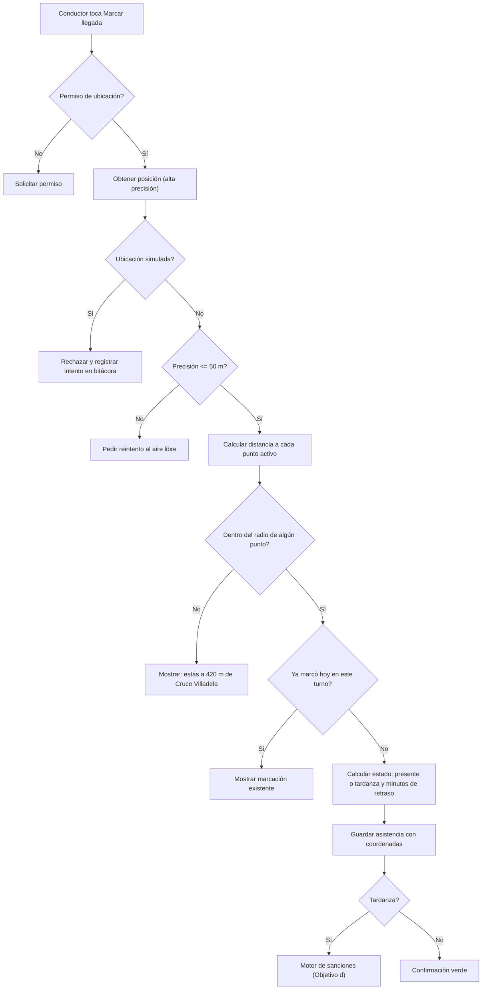
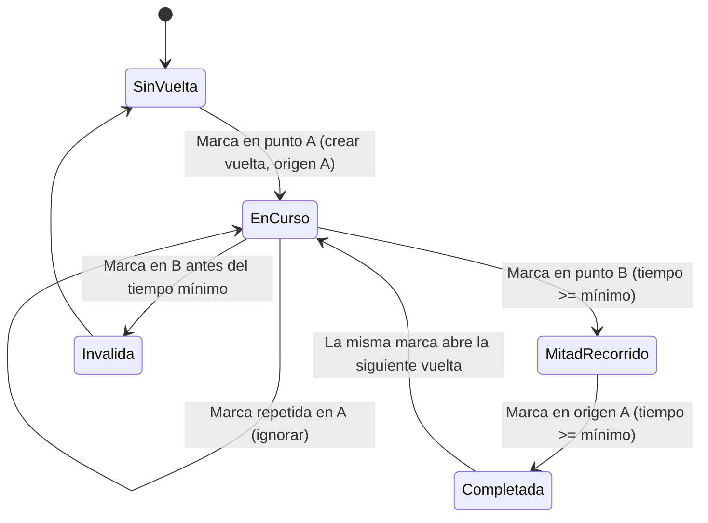
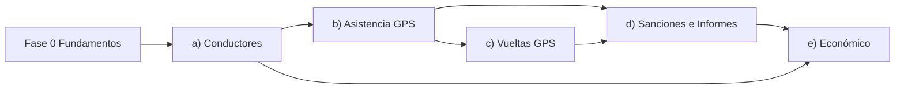

# Plan Técnico por Objetivo — Continental Trufi 101 – 127

> Basado en una revisión del código actual de `continental/lib`. Cada objetivo tiene: **qué pide**, **qué existe hoy**, **qué falta**, **modelo de datos**, **lógica**, **pantallas**, **permisos** y **criterios de aceptación** (sirven para verificar el objetivo ante el tribunal).

---

## 0. Diagnóstico: dónde está la app hoy frente a los objetivos

| Objetivo | Estado actual en el código | Nivel |
|---|---|---|
| a) Registro centralizado de conductores | CRUD básico, `ci` y `placa` son `UNIQUE`. Hay **3 formas distintas** de crear conductores (Registro, Usuarios, Conductores) con lógica duplicada. No hay ficha completa ni edición de vehículo. | 🟡 40% |
| b) Asistencia por GPS | El registro es un **formulario manual** (se elige conductor, punto y estado a mano). **No hay paquete de geolocalización**. Los puntos de control no tienen coordenadas. Puntos sembrados: "Parada Central" y "Terminal Central" (no Villadela / Teleférico Amarillo). | 🔴 15% |
| c) Vueltas por GPS | Registro **manual** con tipo (Completa, Media, Turno). Sin relación con puntos de control ni con sanciones de castigo. | 🔴 10% |
| d) Sanciones e informes | Sanciones manuales con `vueltas_asignadas/cumplidas`. Informes = 4 contadores de un día. No hay detección automática de tardanzas ni exportación. | 🟡 30% |
| e) Control económico | Cuotas con tipo, monto y estado. Tipos sembrados: Mensual, Extraordinaria, Multa. Falta canastón, pasanaco, faltas a reunión, "quién registró", "por qué" y pagos parciales. | 🟡 30% |

> [!WARNING]
> **Correcciones a mi análisis anterior:** el módulo GPS actual es un **mapa estático** (coordenadas fijas en el código, sin ubicación real del celular), y el Panel Técnico **no** monitorea sincronización. Lo describí de más.

### 🔴 Hallazgo crítico: la información NO está centralizada

La base de datos es **SQLite local**: cada celular tiene su propia base. Si el conductor marca asistencia en *su* celular, la directiva **no lo ve** en el *suyo*. El objetivo general dice "**centralice la información**", así que se necesita un servidor/nube. Las columnas `sincronizado`, `created_at` y `updated_at` ya anticipan esto.

| Opción | Ventajas | Desventajas |
|---|---|---|
| **Supabase** (PostgreSQL) ⭐ recomendado | Relacional (el esquema actual migra casi igual), autenticación, tiempo real, plan gratuito, SDK Flutter | Requiere internet para sincronizar |
| Firebase (Firestore) | Muy popular, offline integrado | NoSQL: hay que rediseñar las relaciones (JOINs) |
| API propia (Node/Laravel + MySQL) | Control total, demuestra más desarrollo | Más trabajo y hay que pagar un hosting |

**Arquitectura propuesta: _offline-first_.** SQLite sigue como caché local (para trabajar sin señal en el punto de control). Un `SyncService` sube los registros con `sincronizado = 0` y descarga los cambios. La **hora oficial** de las marcaciones la pone el servidor, para que nadie pueda adelantar el reloj del celular.

---

## FASE 0 — Fundamentos (antes de cualquier objetivo)

### 0.1 Migraciones de base de datos
Hoy `_dbVersion = 1` y **no existe `onUpgrade`**: cualquier cambio de tablas obliga a desinstalar la app y se pierden los datos.
- Implementar `onUpgrade` con migraciones versionadas (`_migrarV2`, `_migrarV3`…) en [database_helper.dart](file:///d:/PROYECTO_GRADO/continental/lib/services/database_helper.dart).
- En SQLite, cambiar un `CHECK` (por ejemplo, agregar un rol) obliga a recrear la tabla: crear `usuario_new`, copiar los datos y renombrar.

### 0.2 Tabla de configuración (sin valores fijos en el código)
```sql
CREATE TABLE configuracion (
  clave TEXT PRIMARY KEY,
  valor TEXT NOT NULL,
  descripcion TEXT,
  updated_at TEXT NOT NULL
);
-- Ejemplos: hora_entrada='06:00', tolerancia_min='10', radio_geocerca_m='80',
-- precision_max_m='50', min_minutos_entre_puntos='15', cierre_jornada='22:00'
```
La directiva la ajusta desde una pantalla **Configuración** (solo superadmin/admin).

### 0.3 Roles
Agregar el rol **`tesorero`** (Secretario de Hacienda) para el objetivo (e). Matriz final:

| Módulo | superadmin | admin | supervisor | tesorero | conductor |
|---|---|---|---|---|---|
| Conductores | ✏️ | ✏️ | 👁️ | 👁️ | — (solo su ficha) |
| Asistencia | ✏️ | ✏️ | ✏️ (manual justificada) | 👁️ | ✏️ (solo GPS propio) |
| Vueltas | ✏️ | ✏️ | ✏️ | 👁️ | ✏️ (solo GPS propio) |
| Sanciones | ✏️ | ✏️ | ✏️ | 👁️ | 👁️ propias |
| Económico | ✏️ | 👁️ | — | ✏️ | 👁️ propias |
| Informes | ✏️ | ✏️ | 👁️ diario | ✏️ económicos | — |
| Configuración / Puntos | ✏️ | ✏️ | — | — | — |

> [!IMPORTANT]
> En el paso anterior le di al **supervisor** acceso de lectura a Cuotas en [permisos.dart](file:///d:/PROYECTO_GRADO/continental/lib/core/permisos.dart). Según el objetivo (e), quizá convenga revertirlo o limitar la pestaña "Cuotas" de la barra inferior según el rol.

### 0.4 Bitácora / auditoría (le da valor ante el tribunal)
```sql
CREATE TABLE bitacora (
  id TEXT PRIMARY KEY, id_usuario TEXT, accion TEXT,  -- 'crear','editar','anular'
  tabla TEXT, id_registro TEXT, detalle TEXT, fecha TEXT
);
```
Toda anulación de sanción, edición de pago o registro manual de asistencia deja rastro.

### 0.5 Paquetes nuevos
| Paquete | Uso |
|---|---|
| `geolocator` | Ubicación, distancia a los puntos y detección de ubicación falsa (`isMocked`) |
| `permission_handler` | Permisos de ubicación |
| `supabase_flutter` (o el que se elija) | Centralización |
| `pdf` + `printing` | Informes y recibos en PDF |
| `excel` | Exportación a Excel |
| `share_plus` | Compartir reportes |
| `fl_chart` | Gráficos en informes |
| `intl` | Fechas y moneda (Bs.) |

### 0.6 Refactor de capas
Hoy las pantallas llaman directo a `DatabaseHelper`. Propuesta:
```
lib/
  services/   database_helper.dart, sync_service.dart, gps_service.dart
  repositories/  conductor_repo.dart, asistencia_repo.dart, vuelta_repo.dart,
                 sancion_repo.dart, economia_repo.dart, informe_repo.dart
  domain/     reglas_asistencia.dart, motor_vueltas.dart, motor_sanciones.dart
```
La lógica de negocio (calcular tardanzas, armar vueltas, generar sanciones) queda en `domain/`, separada de la interfaz y fácil de probar con `flutter_test`.

---

## OBJETIVO a) — Registro centralizado de conductores

> *Almacenar sus datos en un solo lugar y evitar duplicados al incorporar nuevos miembros.*

### a.1 Brechas
1. Tres flujos de alta distintos: [register_screen.dart](file:///d:/PROYECTO_GRADO/continental/lib/screens/register_screen.dart), [usuarios_screen.dart](file:///d:/PROYECTO_GRADO/continental/lib/screens/usuarios_screen.dart) y [conductores_screen.dart](file:///d:/PROYECTO_GRADO/continental/lib/screens/conductores_screen.dart).
2. El duplicado solo se detecta por error de SQLite (`UNIQUE constraint failed`), con un mensaje técnico.
3. No se normaliza: "1234567 LP", "1234567" y " 1234567" se toman como CI distintos. Lo mismo pasa con las placas "2045-ABC" y "2045ABC".
4. Faltan datos: teléfono, número interno, vencimiento de licencia, datos del vehículo (marca, modelo, color), foto.
5. No hay **ficha única** que muestre todo lo del conductor.

### a.2 Modelo de datos (migración v2)
```sql
ALTER TABLE conductor ADD COLUMN ci_normalizado TEXT;      -- solo dígitos, índice UNIQUE
ALTER TABLE conductor ADD COLUMN extension_ci TEXT;        -- LP, CB, SC...
ALTER TABLE conductor ADD COLUMN telefono TEXT;
ALTER TABLE conductor ADD COLUMN numero_interno TEXT;      -- número de móvil en el grupo
ALTER TABLE conductor ADD COLUMN categoria_licencia TEXT;
ALTER TABLE conductor ADD COLUMN vencimiento_licencia TEXT;
ALTER TABLE conductor ADD COLUMN foto TEXT;
ALTER TABLE conductor ADD COLUMN es_propietario INTEGER DEFAULT 1;

ALTER TABLE automovil ADD COLUMN placa_normalizada TEXT;   -- índice UNIQUE
ALTER TABLE automovil ADD COLUMN marca TEXT;
ALTER TABLE automovil ADD COLUMN modelo TEXT;
ALTER TABLE automovil ADD COLUMN color TEXT;
ALTER TABLE automovil ADD COLUMN anio INTEGER;

CREATE UNIQUE INDEX ux_conductor_ci ON conductor(ci_normalizado);
CREATE UNIQUE INDEX ux_auto_placa  ON automovil(placa_normalizada);
CREATE UNIQUE INDEX ux_conductor_interno ON conductor(numero_interno);
```

### a.3 Lógica antiduplicados (3 capas)
1. **Normalización**: `normalizarCi("1.234.567 lp") → "1234567"` y `normalizarPlaca("2045 - abc") → "2045ABC"`.
2. **Validación en vivo**: al salir del campo CI se consulta la base. Si ya existe, se muestra la tarjeta *"Ya registrado: Juan Pérez, móvil 15, estado activo"* con el botón **Ver ficha**. Así no se crea otro registro.
3. **Última barrera**: el índice `UNIQUE`, con el error traducido a un mensaje claro.

Además, **un solo servicio** `ConductorRepo.registrar(...)`, en transacción (usuario + conductor + auto + relación), que usen las tres pantallas.

### a.4 Pantallas
- **Lista de conductores** (ya existe): agregar filtros activo/inactivo y alertas 🔴 SOAT o licencia vencidos.
- **Formulario por pasos** (Stepper): ① Datos personales → ② Licencia → ③ Vehículo → ④ Acceso (CI y contraseña).
- **Ficha del conductor** (nueva): una sola pantalla con pestañas para Datos, Vehículo, Asistencias, Vueltas, Sanciones y Estado de cuenta. Esto demuestra el "**en un solo lugar**".
- **Dar de baja** en lugar de eliminar (estado `inactivo`), para conservar el historial.
- **Autorregistro**: o se quita, o el conductor queda en estado `pendiente` hasta que un admin lo apruebe. Así se evitan cuentas falsas.

### a.5 Criterios de aceptación
- [ ] No se puede registrar dos veces el mismo CI, aunque se escriba con espacios, puntos o extensión.
- [ ] No se puede repetir una placa ni un número interno.
- [ ] La ficha muestra datos, vehículo e historial operativo y económico.
- [ ] Hay alerta visible de SOAT o licencia vencidos o por vencer (30 días).
- [ ] Un solo flujo de alta, usado desde todas las pantallas.

---

## OBJETIVO b) — Asistencia mediante GPS (Cruce Villadela y Teleférico Amarillo)

> *Capturar la llegada en los puntos de control y eliminar el papel y el biométrico → Excel → WhatsApp.*

### b.1 Concepto: geocerca (*geofence*)
Cada punto de control tiene coordenadas y un radio (por ejemplo, 80 m). El conductor toca **"Marcar llegada"** y la app:



### b.2 Modelo de datos
```sql
ALTER TABLE punto_de_control ADD COLUMN latitud REAL;
ALTER TABLE punto_de_control ADD COLUMN longitud REAL;
ALTER TABLE punto_de_control ADD COLUMN radio_m INTEGER DEFAULT 80;
ALTER TABLE punto_de_control ADD COLUMN orden INTEGER;     -- 1 = Villadela, 2 = Teleférico
ALTER TABLE punto_de_control ADD COLUMN activo INTEGER DEFAULT 1;

CREATE TABLE horario (
  id_horario TEXT PRIMARY KEY,
  nombre TEXT,                 -- 'Turno mañana'
  hora_entrada TEXT,           -- '06:00'
  tolerancia_min INTEGER,      -- 10
  hora_limite_falta TEXT,      -- '08:00' (después de esta hora cuenta como falta)
  dias TEXT,                   -- 'L,M,X,J,V,S'
  created_at TEXT, updated_at TEXT, sincronizado INTEGER DEFAULT 0
);

ALTER TABLE asistencia ADD COLUMN id_horario TEXT;
ALTER TABLE asistencia ADD COLUMN latitud REAL;
ALTER TABLE asistencia ADD COLUMN longitud REAL;
ALTER TABLE asistencia ADD COLUMN precision_m REAL;
ALTER TABLE asistencia ADD COLUMN distancia_m REAL;
ALTER TABLE asistencia ADD COLUMN minutos_retraso INTEGER DEFAULT 0;
ALTER TABLE asistencia ADD COLUMN metodo TEXT DEFAULT 'gps';  -- 'gps' | 'manual'
ALTER TABLE asistencia ADD COLUMN registrado_por TEXT;        -- id_usuario
ALTER TABLE asistencia ADD COLUMN justificacion TEXT;         -- obligatoria si es manual
ALTER TABLE asistencia ADD COLUMN hora_servidor TEXT;

CREATE UNIQUE INDEX ux_asistencia_dia
  ON asistencia(id_conductor, fecha, id_horario);
```
**Siembra:** reemplazar "Parada Central / Terminal Central" por **Cruce Villadela** y **Teleférico Amarillo**.

> [!NOTE]
> Las coordenadas **no deben inventarse**. Habrá un botón **"Capturar ubicación actual"** en la pantalla de Puntos de Control: el admin se para físicamente en cada punto, lo toca y se guardan la latitud y la longitud reales.

### b.3 Reglas de cálculo (`domain/reglas_asistencia.dart`)
```text
retraso = hora_llegada - horario.hora_entrada   (en minutos)
si retraso <= tolerancia           → 'presente'
si tolerancia < retraso <= límite  → 'tardanza' (minutos_retraso = retraso)
si no marcó hasta hora_limite_falta → 'falta'  (generada al cerrar la jornada)
```
**Cierre de jornada:** el supervisor toca un botón, o la app lo hace al abrirse después de `cierre_jornada`. Se crean registros `falta` para los conductores activos sin marcación y se dispara el motor de sanciones.

### b.4 Seguridad y antifraude
| Riesgo | Mitigación |
|---|---|
| App de GPS falso | `position.isMocked` (Android) → rechazar y registrar en bitácora |
| Adelantar el reloj del celular | Hora del servidor (con backend); de lo contrario, se guarda la hora del dispositivo con marca de "no verificada" |
| Marcar desde lejos | Geocerca con radio configurable y precisión mínima |
| Marcar por otro conductor | Sesión individual por CI. Opcional: selfie al marcar |
| Celular sin GPS o sin batería | El supervisor registra manualmente con **justificación obligatoria**, marcado como `metodo='manual'` |

### b.5 Pantallas
- **Conductor — "Marcar llegada"**: botón grande, mapa con su posición y las geocercas, distancia en vivo al punto más cercano y resultado (verde/ámbar/rojo).
- **Supervisor — Panel del día**: lista en tiempo real con hora, punto, minutos de retraso y un ícono 📍 (GPS) o ✍️ (manual).
- **Admin — Puntos de control**: mapa, captura de ubicación, ajuste del radio con deslizador y círculo visible.
- **Admin — Horarios**: CRUD de turnos.
- **GPS** ([gps_screen.dart](file:///d:/PROYECTO_GRADO/continental/lib/screens/gps_screen.dart)): reemplazar las coordenadas fijas por los puntos reales de la base, con sus círculos de geocerca y la ubicación del usuario.

### b.6 Permisos de plataforma
- Android: `ACCESS_FINE_LOCATION` y `ACCESS_COARSE_LOCATION` en `AndroidManifest.xml`.
- iOS: `NSLocationWhenInUseUsageDescription` en `Info.plist`.

### b.7 Criterios de aceptación
- [ ] Marcar fuera del radio es rechazado y se muestra la distancia.
- [ ] Con GPS falso activo, la marcación es rechazada.
- [ ] El estado (presente o tardanza) se calcula solo, sin que nadie lo elija.
- [ ] Una sola marcación por conductor, turno y día.
- [ ] Las faltas se generan automáticamente al cerrar la jornada.
- [ ] Cada registro guarda coordenadas, precisión y distancia (evidencia objetiva).

---

## OBJETIVO c) — Control de vueltas mediante GPS (incluye vueltas de castigo)

> *Registrar de forma objetiva los recorridos completados entre ambos puntos, incluidas las vueltas de castigo.*

### c.1 Definición operativa (hay que confirmarla con el sindicato)
- **Marcación de paso**: el registro GPS validado cuando el conductor está en un punto.
- **Vuelta completa**: `Villadela → Teleférico Amarillo → Villadela` (o el criterio que defina la directiva; por ejemplo, ida y vuelta = 1).
- **Tiempo mínimo** entre puntos (configurable, p. ej. 15 min): impide marcar A y B de inmediato sin haber hecho el recorrido.

### c.2 Dos niveles de implementación
| Nivel | Cómo funciona | Pros | Contras |
|---|---|---|---|
| **1. Marcación de paso** ⭐ (núcleo de la tesis) | El conductor toca "Marcar paso" al llegar a cada punto (validado por geocerca, como en b) | Confiable, poco consumo de batería, sin permisos especiales | Requiere un toque |
| **2. Detección automática** (extensión) | Servicio en segundo plano detecta la entrada a la geocerca y marca solo | 100% automático | Pide permiso "ubicación todo el tiempo", consume batería y Android exige notificación permanente y justificación en Play Store |

Recomendación: implementar el **Nivel 1** completo y dejar el **Nivel 2** como mejora, con la misma lógica de armado de vueltas.

### c.3 Modelo de datos
```sql
CREATE TABLE marcacion_punto (
  id_marcacion TEXT PRIMARY KEY,
  id_conductor TEXT NOT NULL,
  id_punto TEXT NOT NULL,
  fecha TEXT NOT NULL, hora TEXT NOT NULL,
  latitud REAL, longitud REAL, precision_m REAL, distancia_m REAL,
  metodo TEXT DEFAULT 'gps',        -- 'gps' | 'auto' | 'manual'
  id_vuelta TEXT,                   -- vuelta a la que se asignó
  created_at TEXT, updated_at TEXT, sincronizado INTEGER DEFAULT 0,
  FOREIGN KEY (id_conductor) REFERENCES conductor(id_conductor),
  FOREIGN KEY (id_punto) REFERENCES punto_de_control(id_punto)
);

ALTER TABLE vueltas ADD COLUMN id_punto_origen TEXT;
ALTER TABLE vueltas ADD COLUMN hora_inicio TEXT;
ALTER TABLE vueltas ADD COLUMN hora_fin TEXT;
ALTER TABLE vueltas ADD COLUMN duracion_min INTEGER;
ALTER TABLE vueltas ADD COLUMN estado TEXT DEFAULT 'en_curso'; -- en_curso|completada|invalida
ALTER TABLE vueltas ADD COLUMN es_castigo INTEGER DEFAULT 0;
ALTER TABLE vueltas ADD COLUMN id_sancion TEXT;               -- FK a sancion
ALTER TABLE vueltas ADD COLUMN metodo TEXT DEFAULT 'gps';
```

### c.4 Algoritmo de armado de vueltas (`domain/motor_vueltas.dart`)

Pseudocódigo:
```text
al registrar marcación M (conductor C, punto P, hora H):
  si hay marcación previa de C en P hace < 3 min → descartar (rebote)
  V = vuelta 'en_curso' de C hoy
  si V no existe → crear V(origen=P, hora_inicio=H); fin
  si P == V.origen y V aún no pasó por el otro punto → ignorar
  si P != V.origen:
      si H - V.hora_inicio < min_minutos → marcar M sospechosa; fin
      registrar paso intermedio
  si P == V.origen y ya pasó por el otro punto:
      V.estado = 'completada', V.hora_fin = H, V.duracion = H - inicio
      asignarCastigoSiCorresponde(V)
      abrir nueva vuelta con origen P (encadenadas)
```

### c.5 Vueltas de castigo
Cuando un conductor tiene una sanción `pendiente` con `vueltas_cumplidas < vueltas_asignadas`:
- **Opción A (automática):** las vueltas que superen su cuota normal del día (p. ej. > 8) se imputan como castigo.
- **Opción B (explícita):** antes de iniciar, el conductor o el supervisor activa "Esta vuelta es de castigo" y elige la sanción.

Al completarse la vuelta: `es_castigo = 1`, `id_sancion = S`, `S.vueltas_cumplidas += 1`. Si llega al total → `S.estado = 'cumplida'`. Todo dentro de una **transacción**.

### c.6 Pantallas
- **Conductor — "Mi jornada"**: botón "Marcar paso", línea de tiempo (06:12 Villadela → 06:48 Teleférico → 07:25 Villadela ✅), contadores *Normales: 5 · Castigo: 1/3 pendientes*.
- **Supervisor — Vueltas del día**: tabla por conductor con normales, castigo, inválidas y tiempo promedio.
- **Detalle de vuelta**: mapa con los puntos marcados y la duración.

### c.7 Criterios de aceptación
- [ ] Una vuelta solo se completa con marcaciones GPS válidas en ambos puntos.
- [ ] Las marcaciones repetidas o demasiado rápidas no generan vueltas.
- [ ] Las vueltas de castigo descuentan de la sanción correcta y la cierran al completarse.
- [ ] El conductor y el supervisor ven el mismo conteo.

---

## OBJETIVO d) — Sanciones e informes

> *Detectar tardanzas, registrar castigos y generar reportes diarios para la directiva.*

### d.1 Motor de sanciones configurable
```sql
CREATE TABLE regla_sancion (
  id_regla TEXT PRIMARY KEY,
  tipo_infraccion TEXT NOT NULL,     -- 'tardanza' | 'falta' | 'falta_reunion' | 'otro'
  minutos_desde INTEGER,             -- p. ej. 11
  minutos_hasta INTEGER,             -- p. ej. 30
  vueltas_castigo INTEGER DEFAULT 0, -- p. ej. 1
  monto_multa REAL DEFAULT 0,        -- p. ej. Bs 10
  activo INTEGER DEFAULT 1,
  created_at TEXT, updated_at TEXT, sincronizado INTEGER DEFAULT 0
);
-- Ejemplo: tardanza 11–30 min → 1 vuelta | 31–60 → 2 vueltas | falta → 3 vueltas + Bs 20

ALTER TABLE sancion ADD COLUMN tipo TEXT;            -- tardanza|falta|falta_reunion|otro
ALTER TABLE sancion ADD COLUMN origen TEXT;          -- 'automatica' | 'manual'
ALTER TABLE sancion ADD COLUMN id_regla TEXT;
ALTER TABLE sancion ADD COLUMN monto_multa REAL DEFAULT 0;
ALTER TABLE sancion ADD COLUMN id_cuota TEXT;        -- multa económica generada (Obj. e)
ALTER TABLE sancion ADD COLUMN registrado_por TEXT;
ALTER TABLE sancion ADD COLUMN anulado_por TEXT;
ALTER TABLE sancion ADD COLUMN motivo_anulacion TEXT;
-- estado: 'pendiente' | 'cumplida' | 'anulada'
```
**Flujo automático:** una asistencia `tardanza` o `falta` busca la regla aplicable y crea la sanción (con `vueltas_asignadas`). Si la regla tiene multa, crea además una **cuota tipo Multa** vinculada (puente con el objetivo e).
**Anulación:** solo admin, con motivo obligatorio y registro en bitácora. Nunca se borra.

### d.2 Informes
| Informe | Contenido | Para |
|---|---|---|
| **Diario** ⭐ | Presentes, tardanzas (con minutos), faltas, vueltas por conductor (normales/castigo), sanciones generadas y cumplidas, recaudación del día | Directiva |
| Rango (semanal/mensual) | Tendencias, ranking de puntualidad, conductores con más sanciones | Directiva |
| Por conductor | Kardex completo: asistencia, vueltas, sanciones, deudas | Directiva / conductor |
| Económico | Recaudado vs pendiente por tipo de cuota y por mes | Tesorero |

**Salidas:**
- En pantalla, con gráficos (`fl_chart`): barras de asistencia por día y torta de estados.
- **PDF** con logo, fecha, tablas y firma (`pdf` + `printing`).
- **Excel** (`excel`), para quien todavía lo usa.
- **Compartir** con un toque (`share_plus`). Con el backend, la directiva lo ve **en la app en tiempo real** y ya no depende de WhatsApp.

### d.3 Cierre de jornada (une b, c y d)
Botón **"Cerrar día"** (supervisor/admin): ① generar faltas → ② aplicar reglas → ③ cerrar vueltas `en_curso` como `invalida` → ④ guardar una foto del informe (`informe_diario`) → ⑤ notificar a la directiva.

### d.4 Criterios de aceptación
- [ ] Una tardanza genera su sanción **sin intervención humana**, según la regla vigente.
- [ ] Las reglas se cambian desde la app, sin tocar el código.
- [ ] Las anulaciones quedan auditadas.
- [ ] El informe diario se genera en PDF en menos de 5 segundos y se puede compartir.

---

## OBJETIVO e) — Control económico (Secretario de Hacienda)

> *Cuotas de ayuda, canastón de fin de año, multas, faltas a reuniones y pasanaco, con quién pagó, cuánto y por qué.*

### e.1 Modelo: separar **obligación** (lo que se debe) de **pago** (lo que se abona)
Así se pueden registrar pagos parciales y emitir recibos.
```sql
-- Catálogo
ALTER TABLE tipo_cuota ADD COLUMN monto_sugerido REAL;
ALTER TABLE tipo_cuota ADD COLUMN descripcion TEXT;
ALTER TABLE tipo_cuota ADD COLUMN activo INTEGER DEFAULT 1;
-- Siembra: 'Cuota de ayuda', 'Canastón fin de año', 'Multa',
--          'Falta a reunión', 'Pasanaco'

-- Obligación (la tabla 'cuota' actual, ampliada)
ALTER TABLE cuota ADD COLUMN concepto TEXT;          -- "POR QUÉ" (ej. 'Ayuda a familia de X')
ALTER TABLE cuota ADD COLUMN monto_pagado REAL DEFAULT 0;
ALTER TABLE cuota ADD COLUMN fecha_vencimiento TEXT;
ALTER TABLE cuota ADD COLUMN registrado_por TEXT;    -- tesorero que la registró
ALTER TABLE cuota ADD COLUMN id_sancion TEXT;        -- si viene de una multa
ALTER TABLE cuota ADD COLUMN id_reunion TEXT;        -- si viene de una falta a reunión
ALTER TABLE cuota ADD COLUMN id_ronda TEXT;          -- si es un aporte de pasanaco
ALTER TABLE cuota ADD COLUMN id_lote TEXT;           -- cobro masivo que la generó
-- estado: 'pendiente' | 'parcial' | 'pagado' | 'anulado'

CREATE TABLE pago (
  id_pago TEXT PRIMARY KEY,
  id_cuota TEXT NOT NULL,                  -- qué obligación paga
  id_conductor TEXT NOT NULL,              -- "QUIÉN" pagó
  monto REAL NOT NULL CHECK (monto > 0),   -- "CUÁNTO"
  fecha TEXT NOT NULL, hora TEXT NOT NULL,
  metodo TEXT DEFAULT 'efectivo',          -- efectivo | qr | transferencia
  nro_recibo TEXT UNIQUE,                  -- correlativo REC-2026-000123
  registrado_por TEXT NOT NULL,            -- tesorero
  observacion TEXT,
  created_at TEXT, updated_at TEXT, sincronizado INTEGER DEFAULT 0,
  FOREIGN KEY (id_cuota) REFERENCES cuota(id_cuota)
);
```

### e.2 Reuniones → faltas a reunión
```sql
CREATE TABLE reunion (
  id_reunion TEXT PRIMARY KEY, fecha TEXT, hora TEXT, tema TEXT,
  monto_multa_falta REAL, estado TEXT,   -- programada | realizada
  created_at TEXT, updated_at TEXT, sincronizado INTEGER DEFAULT 0
);
CREATE TABLE asistencia_reunion (
  id_reunion TEXT, id_conductor TEXT,
  estado TEXT,                           -- presente | falta | licencia
  PRIMARY KEY (id_reunion, id_conductor)
);
```
Al cerrar una reunión, cada `falta` genera automáticamente una cuota tipo **Falta a reunión** con el monto definido.

### e.3 Pasanaco
```sql
CREATE TABLE pasanaco (
  id_pasanaco TEXT PRIMARY KEY, nombre TEXT, monto_aporte REAL,
  periodicidad TEXT,                     -- semanal | quincenal | mensual
  fecha_inicio TEXT, estado TEXT,        -- activo | finalizado
  created_at TEXT, updated_at TEXT, sincronizado INTEGER DEFAULT 0
);
CREATE TABLE pasanaco_participante (
  id_pasanaco TEXT, id_conductor TEXT, orden_turno INTEGER,
  PRIMARY KEY (id_pasanaco, id_conductor)
);
CREATE TABLE pasanaco_ronda (
  id_ronda TEXT PRIMARY KEY, id_pasanaco TEXT, numero INTEGER,
  fecha TEXT, id_beneficiario TEXT,      -- a quién le toca cobrar
  monto_total REAL, estado TEXT,         -- pendiente | entregada
  created_at TEXT, updated_at TEXT, sincronizado INTEGER DEFAULT 0
);
```
Funciones: crear el pasanaco → elegir participantes → **sorteo** del orden → por cada ronda se generan las cuotas de aporte de todos → al completarse, se marca "entregada" al beneficiario.

### e.4 Funciones clave para el tesorero
1. **Registrar pago** en 3 toques: buscar conductor → ver sus deudas pendientes → cobrar (total o parcial) → **recibo PDF** con correlativo.
2. **Cobro masivo**: "Canastón 2026, Bs 150 a todos los activos" genera N obligaciones de una vez (`id_lote`).
3. **Estado de cuenta por conductor**: debe, pagó, saldo, detalle por tipo. Lo ve también el conductor (solo el suyo).
4. **Panel de Hacienda**: recaudado hoy/mes, pendiente total, por tipo, top deudores, gráfico mensual.
5. **Consulta inmediata** con filtros por tipo, rango de fechas, conductor y estado.

### e.5 Criterios de aceptación
- [ ] Cada pago registra **quién** (conductor), **cuánto** (monto), **por qué** (tipo + concepto) y **quién cobró** (tesorero).
- [ ] Se admiten pagos parciales y el saldo se recalcula solo.
- [ ] Las multas por sanción y las faltas a reunión aparecen solas como deuda.
- [ ] El pasanaco gestiona el orden, los aportes por ronda y la entrega.
- [ ] Se genera recibo PDF con número correlativo único.
- [ ] El tesorero consulta el saldo de cualquier conductor en menos de 3 toques.

---

## Cronograma sugerido (sprints de 1–2 semanas)

| Sprint | Contenido | Entregable demostrable |
|---|---|---|
| S0 | Fase 0: migraciones, configuración, roles, refactor de repositorios, decisión de backend | App actualizada sin perder datos |
| S1 | Objetivo a | Ficha única y antiduplicados |
| S2 | Objetivo b (parte 1): puntos con coordenadas, horarios, servicio GPS | Marcación con geocerca en campo |
| S3 | Objetivo b (parte 2): antifraude, registro manual, cierre de jornada | Asistencia 100% sin papel |
| S4 | Objetivo c: marcaciones de paso y motor de vueltas | Conteo objetivo de vueltas |
| S5 | Objetivo c + d: castigos y motor de sanciones | Tardanza → sanción → vuelta de castigo, de punta a punta |
| S6 | Objetivo d: informes, PDF, Excel, gráficos | Informe diario exportable |
| S7 | Objetivo e (parte 1): pagos, recibos, cobro masivo, estado de cuenta | Módulo de tesorería operativo |
| S8 | Objetivo e (parte 2): reuniones y pasanaco | Ciclo económico completo |
| S9 | Sincronización con la nube, pruebas y **piloto en Villadela y Teleférico** | Evidencia para la defensa |



---

## Preguntas abiertas (necesito tus respuestas para afinar el plan)

1. **Centralización:** ¿usamos **Supabase**, Firebase o una API propia? ¿O el tribunal acepta una versión solo local?
2. **Definición de vuelta:** ¿una vuelta completa es Villadela → Teleférico → Villadela, o cada tramo cuenta?
3. **Horarios:** ¿hay un solo horario de entrada o varios turnos? ¿Cuántos minutos de tolerancia?
4. **Reglas de castigo:** ¿cuántas vueltas de castigo corresponden por tardanza o falta? ¿Hay multa en dinero?
5. **Marcación:** ¿todos los conductores tienen smartphone con GPS, o el supervisor marca por ellos desde su celular?
6. **Secretario de Hacienda:** ¿creamos el rol `tesorero`? ¿El supervisor debe ver las cuotas?
7. **Autorregistro:** ¿se mantiene (con aprobación del admin) o se elimina?
8. **Pasanaco:** ¿el orden es por sorteo o lo define la directiva? ¿Cuál es la periodicidad?
9. **Vueltas automáticas (Nivel 2):** ¿las quieres en la tesis o basta con la marcación por toque?
