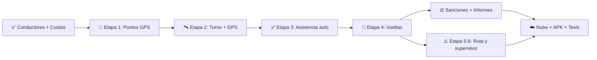

# 🗂️ Tablero Kanban — Continental Trufi 101 – 127

> Construido revisando **todo el chat** (21–25 oct 2026), los planes `plan_objetivos` y `plan_datos_conductor`, el código actual y los commits en GitHub.
> Última actualización: 25 oct 2026 · Rama `main` sincronizada (`69d2272`).

---

## 📊 Vista general del tablero

| ✅ HECHO | 🟡 A MEDIAS / POR PULIR | 🔜 SIGUIENTE (GPS) | 📋 PENDIENTE (Backlog) |
|---|---|---|---|
| Login, sesión y roles (RBAC) | Asistencia (manual) | Etapa 1: Puntos con coordenadas | Centralizar en la nube |
| Directorio + Conductores en tarjetas | Vueltas (manual) | Etapa 2: Servicio GPS y turno | Motor de sanciones automático |
| Ficha del conductor (👁️) | Sanciones (manual) | Etapa 3: Asistencia automática | Informes completos (PDF/Excel) |
| Crear/Editar conductor (pantalla) | Informes (solo 4 contadores) | Etapa 4: Detección de vuelta | Reuniones y Pasanaco (conectar) |
| 20 conductores sembrados | GPS (mapa estático) | Etapa 5: Ruta y alerta | Bitácora y configuración |
| Foto + avatar por defecto | Pantallas de cuotas sin conectar | Etapa 6: Pantallas supervisor | Pruebas en calle + APK |
| Control de Cuotas completo | Columnas sin usar en `cuota` | Etapa 7: Calle y APK | Redacción Capítulo III |
| Informe PDF por cuota | | | |
| Subido a GitHub (2 commits) | | | |

---

## ✅ HECHO

### 🧱 Base y navegación
- [x] Análisis de módulos del proyecto (explicación inicial)
- [x] Base de datos SQLite local con migraciones versionadas (hoy **v7**)
- [x] Gestión de sesión y control de acceso por rol (`superadmin`, `admin`, `supervisor`, `tesorero`, `conductor`)
- [x] Corregido el error al **crear conductor**
- [x] Quitado el modal feo de "usuario creado" → mensaje limpio de éxito
- [x] Barra inferior: **Inicio · Asistencias · Vueltas · Cuotas** (se quitó "Usuarios")
- [x] **Menú hamburguesa ☰** con panel lateral izquierdo
- [x] Logo del sindicato **translúcido y estético** de fondo

### 👥 Objetivo a) Registro de conductores
- [x] Vista **Usuarios dividida**: ahora un solo **Directorio** + **Conductores**
- [x] Conductores y directorio en **tarjetas cuadradas** (ya no lista)
- [x] Botón **👁️ ojito** para ver la información de cada conductor
- [x] **Pantalla propia** de ficha del conductor (no modal), con el mismo diseño
- [x] Plan de datos de la ficha (qué campos reales vs. simulados)
- [x] Base de datos **duplicada fuera** de la carpeta del proyecto (`continental_dump.sql`)
- [x] Nuevas columnas en `conductor` y `automovil` (teléfono, nacimiento, dirección, estado civil, licencia, SOAT, RUAT, marca, modelo, color, capacidad…)
- [x] **Crear/Editar conductor en pantalla completa** (ya no modal) pidiendo todos los datos
- [x] **Foto de perfil** funcional (`image_picker`) y **avatar** si no hay foto
- [x] **20 conductores oficiales** cargados con credenciales y vehículos (`seed_data.dart`)
- [x] Alertas de SOAT / licencia por vencer (`documentos_alerta.dart`)

### 💰 Objetivo e) Control económico
- [x] Tablas `tipo_cuota`, `cuota`, `pago` (+ `reunion`, `pasanaco`, `ronda_pasanaco`)
- [x] Reinicio limpio: **sin cuotas precargadas**
- [x] Pantalla **Control de Cuotas** reordenada y simplificada
- [x] **3 cuadrados informativos** que filtran: *Ya pagaron* · *No pagaron* · *Total cuota* (con cantidad y Bs.)
- [x] Cobro rápido por conductor (total o parcial), verde = pagó / rojo = falta
- [x] Quitado el **recibo** (no era necesario)
- [x] **Informe PDF** de todas las cuotas de todos los conductores
- [x] Crear cuota con **Título + Motivo + Monto por chofer**
- [x] Tarjeta superior mostrando Título, Motivo y Monto
- [x] **Editar cuota** · eliminar cuota · borrar todas
- [x] Tarjeta **"Cuotas"** del inicio muestra *cantidad de cuotas creadas* (no Bs.) y abre el módulo
- [x] Análisis de columnas usadas / sin usar en la tabla `cuota`

### 🔧 Entorno
- [x] Resuelto el aviso al correr/emular (botón *Sobrescribir*) y la app corre en `emulator-5554`
- [x] `flutter analyze` → **0 problemas**
- [x] **2 commits subidos a GitHub** (conductores + economía)

### 📝 Planeación entregada
- [x] Plan técnico por objetivos a–e (`plan_objetivos.md`)
- [x] Plan de vistas del objetivo e)
- [x] Plan GPS en 7 etapas y explicación de cada una

---

## 🟡 A MEDIAS / POR PULIR

| # | Tarea | Estado hoy | Qué falta |
|---|---|---|---|
| 1 | **Asistencia** (obj. b) | Formulario **manual** (eliges conductor/punto) | Que sea automática por GPS |
| 2 | **Vueltas** (obj. c) | Registro **manual** (Completa/Media/Turno) | Detección automática A→B→A |
| 3 | **Sanciones** (obj. d) | Manual con vueltas asignadas/cumplidas | Generarlas solas por tardanza/falta |
| 4 | **Informes** (obj. d) | 4 contadores de un día | PDF/Excel diario, gráficos, por conductor |
| 5 | **GPS** | Mapa con coordenadas fijas en código | Ubicación real y puntos desde la BD |
| 6 | **Puntos de control** | Solo "Parada Central" y "Terminal Central" **sin coordenadas** | Cruce Villadela y Teleférico Amarillo reales |
| 7 | **Pantallas de economía huérfanas** | Existen pero **no están conectadas** al menú: `cobro_masivo`, `caja_del_dia`, `cuotas_lista`, `estado_cuenta`, `informe_economico`, `pasanaco`, `reuniones`, `tipos_cuota` | Decidir: conectarlas o eliminarlas |
| 8 | **Columnas sin uso en `cuota`** | `fecha_vencimiento`, `id_lote`, `motivo_anulacion`, `id_reunion`, `id_ronda` (todas en NULL) | Decidir: borrarlas o usarlas luego |
| 9 | **Pantallas sin referencia** | `register_screen`, `welcome_screen` no se importan en ningún lado | Decidir: autorregistro sí/no |

---

## 🔜 SIGUIENTE — Sprint GPS (una etapa a la vez)

### 📍 Etapa 1 · Puntos de control con coordenadas ← **EMPEZAR AQUÍ**
- [ ] Instalar `geolocator`, `permission_handler`, `flutter_foreground_task`
- [ ] Permisos Android (ubicación precisa, segundo plano, servicio en primer plano, notificaciones)
- [ ] BD v8: `latitud`, `longitud`, `radio_metros` (40 m), `tipo` en `punto_de_control`
- [ ] Reemplazar puntos de prueba por **Cruce** y **Teleférico Amarillo**
- [ ] Pantalla admin con **mapa**, círculo del radio y botón **"Usar mi ubicación actual"**
- ✔️ *Listo cuando:* ves el Cruce y el Teleférico en el mapa

### 🛰️ Etapa 2 · Servicio GPS y turno
- [ ] Botón **Iniciar / Terminar turno** (conductor)
- [ ] Servicio en 2.º plano con notificación "Rastreo activo", lectura cada 5 s
- [ ] Tabla `turno`
- ✔️ *Listo cuando:* sigue leyendo con la pantalla apagada

### ✅ Etapa 3 · Asistencia automática
- [ ] Marcar sola al entrar a ≤ radio del punto
- [ ] Una asistencia por punto por día
- ✔️ *Listo cuando:* aparece en `asistencia_screen` sin tocar nada

### 🔄 Etapa 4 · Detección de vuelta
- [ ] Máquina de estados A → B → A guardada en `turno`
- ✔️ *Listo cuando:* un A→B→A crea 1 fila en `vueltas`

### ⚠️ Etapa 5 · Ruta y alerta de desvío
- [ ] Modo "grabar ruta" (`ruta`, `ruta_punto`)
- [ ] Distancia a la ruta; 3 lecturas fuera de 60 m → tabla `alerta`

### 📱 Etapa 6 · Pantallas del supervisor
- [ ] Mapa con ruta y posición del conductor + lista de alertas
- [ ] Conectar con `gps_screen`, `vueltas_screen`, `asistencia_screen`

### 🚗 Etapa 7 · Pruebas en calle y APK
- [ ] Recorrer la ruta real y ajustar radio / tolerancia
- [ ] Generar APK

### ❓ Decisiones tuyas que bloquean etapas
| Para | Pregunta |
|---|---|
| Etapa 3 | ¿Hay **hora límite** (ej. después de 06:00 = "tarde") o solo se guarda la hora de llegada? |
| Etapa 5 | ¿Ida y vuelta van por la **misma calle** o por calles distintas? |
| Riesgo | ¿Qué **marca de celular** usa tu papá? (Xiaomi/Huawei matan apps en 2.º plano) |
| Etapa 1 | Ir **físicamente** al Cruce y al Teleférico para guardar coordenadas reales |

---

## 📋 PENDIENTE — Backlog (del plan por objetivos)

### 🧱 Fase 0 · Fundamentos
- [ ] Tabla `configuracion` (hora de entrada, tolerancia, radio, precisión…) + pantalla de ajustes
- [ ] **Bitácora / auditoría** (anulaciones, ediciones, registros manuales)
- [ ] Refactor en capas (`repositories/`, `domain/`) — hoy hay `economia_repo` pero el resto llama directo a `DatabaseHelper`
- [ ] Rol/permisos: revisar qué ve el **supervisor** en cuotas

### 👥 Objetivo a)
- [ ] **Normalizar CI y placa** (evitar duplicados "1234567 LP" vs "1234567")
- [ ] Validar duplicado **en vivo** con tarjeta "Ya registrado… Ver ficha"
- [ ] **Dar de baja** (inactivo) en vez de eliminar
- [ ] Número interno único por móvil
- [ ] Decidir sobre autorregistro (con aprobación del admin)

### 📍 Objetivo b)
- [ ] Tabla `horario` (entrada, tolerancia, límite de falta)
- [ ] Cálculo automático presente / tardanza / falta
- [ ] **Antifraude**: rechazar GPS falso (`isMocked`) y marcar desde lejos
- [ ] Registro **manual justificado** (supervisor)
- [ ] **Cierre de jornada** (genera faltas automáticamente)

### 🔄 Objetivo c)
- [ ] `marcacion_punto` + tiempo mínimo entre puntos
- [ ] **Vueltas de castigo** que descuentan de la sanción correcta

### ⚖️ Objetivo d)
- [ ] `regla_sancion` configurable (tardanza 11–30 min → 1 vuelta, etc.)
- [ ] Tardanza/falta → sanción automática (+ multa económica vinculada)
- [ ] Anulación solo admin con motivo
- [ ] **Informe diario PDF** (< 5 s) + Excel + gráficos (`fl_chart`) + compartir
- [ ] Informes: rango, por conductor, económico

### 💰 Objetivo e)
- [ ] Conectar **reuniones** → falta = cuota automática
- [ ] Conectar **pasanaco** (sorteo, rondas, entrega)
- [ ] **Cobro masivo** y **estado de cuenta** accesibles desde el menú (si se decide conservarlos)
- [ ] Multas por sanción que aparezcan solas como deuda
- [ ] Panel de Hacienda (recaudado hoy/mes, top deudores)

### ☁️ Centralización
- [ ] Decidir backend: **Supabase** ⭐ / Firebase / API propia
- [ ] `SyncService` offline-first (columnas `sincronizado` ya existen)
- [ ] Hora oficial del servidor

### 🎓 Tesis
- [ ] Pruebas de aceptación en campo (sirven para el **Capítulo III**)
- [ ] Piloto en Villadela y Teleférico
- [ ] Evidencias para la defensa

---

## 🧭 Ruta recomendada

> [!TIP]
> Lo más rentable ahora: **Etapa 1 (GPS)** — desbloquea asistencia, vueltas y alertas — y en paralelo **decidir qué hacer con las 8 pantallas de economía sin conectar** para dejar el código limpio.
